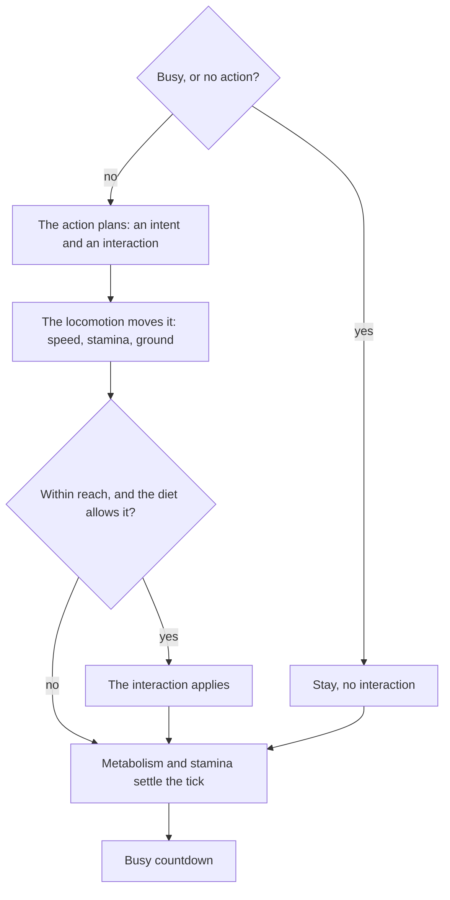

# Actions and movement

The brain only picks an action. The action then does the work, every tick until the animal's next decision: it looks
for its target, says where the animal wants to go and what to do on arrival. The species' **locomotion** moves the
animal, an **interaction** (graze, strike, scavenge) happens if the target is within reach, and the **metabolism**
charges the tick. This split keeps actions short and readable, and lets each species move in its own way (07).

## One animal's act step

The act phase (<xref:EvoSim.ActPhase>) runs these steps for every living animal, in the act order:

1. **Plan.** The animal's action receives an <xref:EvoSim.ActContext> and calls its methods. Nothing moves yet.
2. **Move.** The species' <xref:EvoSim.Locomotion> turns the intent into a movement and reports the meters moved.
3. **Interact.** The <xref:EvoSim.InteractionResolver> applies the planned interaction if the target is within reach,
   still there, and allowed by the eater's diet.
4. **Settle.** <xref:EvoSim.Metabolism> charges energy for what the animal did, and <xref:EvoSim.Stamina> pays the
   meters or recovers. A busy animal's countdown drops by one.

An action done in passing, an **overlay** such as a call (ACT-07), runs beside the animal's action, its **carrier**. In
step 1 the carrier plans the intent and its interaction as above, then the overlay plans in the same context: its intent
is ignored and only its interaction is kept. In step 3 both apply, the carrier's first. In step 4 the overlay's own
countdown drops (once by default); it also ends at the next decision, when the animal becomes busy, or when it dies.
The inspector shows both: "flee + alarm". See [Actions done in passing](../extending/action.md#actions-done-in-passing).

## Planning with the act context

An action never moves an animal and never changes another one (ACT-06). It only asks questions and states a plan:

| Kind | Methods | What they do |
|---|---|---|
| Queries | `NearestAnimal`, `NearestReadyPartner`, `NearestResource`, `NearestCarcass`, `NearestEgg`, `NearestEntity<T>`, `NearestCover`, `InCover`, `IsReady`, `Vision` | Return only what the animal's senses could report: within its vision (20 m in the reference), never itself, never a killed animal, never an animal hidden from it in cover (ACT-05). `null` means nothing in sight. |
| Intents | `WalkTo`, `RunTo` (a point or an animal, with a stop distance), `RunAwayFrom`, `WalkAwayFrom`, `Stay`, `Wander`, `Search` | Say where to go this tick. Running uses the species' running speed. |
| Arrival | `OnArrival(Interaction)`, `OnArrival(IInteraction)` | Say what to do once within reach: graze, strike, scavenge, eat an egg, or a custom effect. |

Before each action runs, the context is reset to *stay, no interaction*. The intent methods replace each other: **the
last call wins**. The same goes for `OnArrival`. An action that calls nothing makes the animal stay.

`WalkTo` and `RunTo` stop at the given distance and never overshoot it (MOVE-04). An animal already within that
distance stays. The action looks its target up again every tick, so it follows a moving target (ACT-02).

## The reference actions

| Action | Class | Target | Intent | On arrival | Searches when |
|---|---|---|---|---|---|
| eat | <xref:EvoSim.EatAction> | nearest food item of a layer its diet grazes | walk to it (stop 0); stay if already on it | graze, on the tick of arrival too | no food in sight |
| flee | <xref:EvoSim.FleeAction> | nearest threat | run straight away from it | — | no threat in sight |
| hide | <xref:EvoSim.HideAction> | nearest cover | walk (or run) into it; stay once inside | — | no cover in sight, or no cover module |
| follow | <xref:EvoSim.FollowAction> | nearest animal of its own species | walk toward it, stop at 1 m | — | no kin in sight |
| rest | <xref:EvoSim.RestAction> | — | stay | — | never |
| mate | <xref:EvoSim.MateAction> | nearest ready partner | walk toward it, stop at 1 m | — (the breed phase breeds it) | no ready partner in sight |
| hunt | <xref:EvoSim.HuntAction> | the nearer of the nearest prey and the nearest carcass it may eat; a carcass wins a tie | run toward it, stop at 1 m | strike the prey, or scavenge the carcass | neither in sight |

The prey has eat, flee, hide, follow, rest and mate; the predator has hunt, follow, rest and mate (04 §5). Flee has
an option from the prototype, **Flee Into Cover** (off in the reference): an animal already in cover stays, and cover
within **Cover Seek** meters (6) is run into instead of running away. Mating itself is not an interaction: the mate
action only brings the animal next to a partner, and the breed phase does the rest (ACT-13).

## Searching

When an action has nothing to act on, it calls `Search()` (ACT-04). The animal **wanders**: it keeps its heading, and
each tick turns by ±45° or ±90° with probability **Wander Turn P** (0.25 on the locomotion). Blocked by a border or an
obstacle, it picks a new random heading. It walks.

The first search after a decision sets the animal's `Searching` flag and counts one *invalid* choice for its species
(the prototype's name). The next decision clears the flag. The `<species>_invalid` column of `stats.csv` counts them.

## Busy animals

A busy animal (<xref:EvoSim.Animal.BusyTicks> above 0) doesn't decide and doesn't move: the act phase gives it a
stay plan with no interaction. It pays the rest cost and recovers stamina. The counter drops by one at the end of
each tick that started busy. When it reaches 0, the animal has no action and decides at the start of the next tick
(ANIM-30). In the reference only digestion makes animals busy: see [Animals, stats and death](animals-and-stats.md).

## Moving

Each species has exactly one locomotion component (MOVE-01, V-13). The reference <xref:EvoSim.KinematicLocomotion>
moves in straight lines, without physics (MOVE-04):

1. The distance is the smallest of the speed (the animal's `speed.walk` or `speed.run` trait), its **stamina budget**
   and the intent's maximum distance. A stop distance is therefore never overshot.
2. <xref:EvoSim.Ground.SlideTo(UnityEngine.Vector3,UnityEngine.Vector3)> moves along that line as far as walkable
   ground allows. Blocked by a border or an obstacle, the animal slides along it.
3. If that made no progress, <xref:EvoSim.Ground.SideStep(UnityEngine.Vector3,System.Single,EvoSim.RandomStream)>
   takes a step of the same length in a random direction, drawn from the species' `actions` stream.
4. The locomotion sets the position and returns the meters moved (MOVE-06).

The stamina budget is the animal's stamina in meters (ANIM-21): an exhausted animal can't move, whatever it chose. A
species without a stamina module has no limit. Whatever the locomotion does is the tick's result (MOVE-01); after it,
the act phase turns the animal toward where it moved (a wandering animal keeps its own heading). If a locomotion ever
leaves an animal on non-walkable ground, the act phase puts it back and logs a warning (MOVE-02).

Speeds are traits, so number genes can change them (MOVE-03). Reference: prey walk and run 1 m per tick, predators
walk 1 and run 2. A predator outruns a prey over short chases; the prey has twice the stamina (07 §4).

## Interactions and reach

After moving, in the same tick, the planned interaction applies if the target is within reach (ACT-10) and both
sides allow it: the target has an <xref:EvoSim.Edible> component and the eater's <xref:EvoSim.Diet> lists it
(SPEC-13). See [The food web](food-web.md).

| Interaction | Built with | Reach (reference) | Effect |
|---|---|---|---|
| graze | `Interaction.Graze(item)` | 0.5 m from the item | the item is consumed (an item goes to the first animal that reaches it); the eater gains its energy |
| strike | `Interaction.Strike(animal)` | 1 m | with the hunter's kill chance, the prey is killed; the hunter eats it and digests; a carcass may appear |
| scavenge | `Interaction.Scavenge(carcass)` | 1 m | one portion is eaten; the eater gains its energy and digests |
| eat egg | `Interaction.EatEgg(egg)` | 0.5 m | the egg is eaten and never hatches (REPRO-23) |
| custom | `OnArrival(IInteraction)` | its own `Reach`, from the point the intent was heading to | whatever its `Apply` does |

**Kills.** A hunter strikes at most once per tick (ACT-12); a miss uses that strike too. The chance that a strike
kills is the hunter's `kill.chance` trait (**Kill Chance** on its diet, 0.5 in the reference), drawn from the hunter
species' `actions` stream. An animal standing in cover that hides it from the hunter is never struck (ENV-11). A
killed animal is marked at once: for the rest of the tick it is not sensed, not targeted, doesn't act and doesn't
breed. It is removed in the death phase (ANIM-41). A prey that survives a strike can be struck again by another
hunter in the same tick.

## Act order

The act order is the **Order** setting of the act phase (ACT-30). The random orders come from the `act-order`
stream, so a seed repeats them (ACT-32).

| Order | How animals take turns |
|---|---|
| Species In Turn (reference) | species in the World's order; within a species, a fresh random order each tick. Each animal plans, moves, interacts and settles before the next one starts, so prey move before predators strike. |
| All Mixed | every animal of every species in one fresh random order each tick, one after another. |
| Simultaneous | every action plans from the state at the start of the phase; each locomotion moves its animals as a group; interactions apply in a fresh random order (a contested item goes to the first one drawn); then every animal that was not killed settles. |

In the two sequential orders an animal acts on the state left by those before it: positions, eaten items, kills
(ACT-31). Reference numbers are measured with *Species In Turn* (ACT-33).

## After the move: the metabolism

Each living animal then pays for its tick, once (ANIM-20): a base cost plus a cost per meter moved, or a lower rest
cost when it stood still resting or busy, plus any extra cost its locomotion reports (slopes, mud). Then its stamina
pays the meters moved, or recovers. The numbers are in [Animals, stats and death](animals-and-stats.md).

## The main types

| Type | Role |
|---|---|
| <xref:EvoSim.AnimalAction> | A behaviour the brain can choose; plans one tick through the context |
| <xref:EvoSim.ActContext> | What an action may ask and plan; reused for every animal |
| <xref:EvoSim.Intent> | Where the animal wants to go: direction, walk or run, farthest distance |
| <xref:EvoSim.Interaction> | What to do on arrival: graze, strike, scavenge, eat an egg, or custom |
| <xref:EvoSim.Locomotion> | How a species moves; <xref:EvoSim.KinematicLocomotion> is the reference |
| <xref:EvoSim.MoveContext> | What a locomotion gets: ground, distance, random streams, stamina budget |
| <xref:EvoSim.InteractionResolver> | Applies interactions after moving: reach, diet, kill chance |
| <xref:EvoSim.ActPhase> | Runs the whole act step in the act order |

## Settings

| Where | Field | Reference | Meaning |
|---|---|---|---|
| Act phase | Order | Species In Turn | the act order |
| Act phase | Graze Reach, Strike Reach, Scavenge Reach | 0.5, 1, 1 m | how close an interaction needs the animal; eggs use the graze reach |
| Locomotion | Walk Speed, Run Speed | prey 1 and 1, predator 1 and 2 m per tick | defaults of the `speed.walk` and `speed.run` traits |
| Locomotion | Wander Turn P | 0.25 | chance per tick that a wandering animal turns |
| Diet | Kill Chance | 0.5 | default of the hunter's `kill.chance` trait |
| Follow, Mate, Hunt | Stop At | 1 m | stop this far from the target |
| Eat | Target | empty | a layer name, empty for every layer the diet grazes, or `egg:<species>` |
| Flee | From, Listed | Threats | whom to flee: the species' threats, or listed species by id or name |
| Hide | Run | off | run into cover instead of walking |

## In the editor

- **Scene view**, in Play mode: select an animal to see its vision, a line to its target and a circle coloured by its
  action. The EvoSim overlay can write each animal's action letter above it.
- **Animal Inspector** (*Window ▸ EvoSim ▸ Animal Inspector*): the selected animal's current action and target, its
  busy reason, its stats.

## Go further

- [Add an action or an interaction](../extending/action.md), [Add a locomotion](../extending/locomotion.md).
- [The food web](food-web.md): who may eat whom, and what a meal gives.
- [A tick, phase by phase](the-tick.md): where the act phase sits in the tick.
- Specification: [07 — Actions and locomotion](../spec/07-actions-and-locomotion.md).
