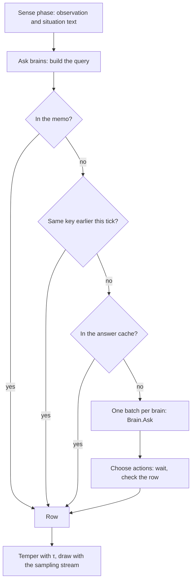

# Decisions and brains

An animal does not choose every tick. Every few ticks it **decides**: its senses describe its situation, a **brain**
reads that situation with the animal's genes and gives one probability per action, and the animal draws its next
action from those probabilities. The brain is usually a language model, so it is the slow part of a run. Most of this
page is about asking it as little as possible: answers are remembered, shared and cached, and the run still repeats
exactly with its seed ([08 — Decisions, brains and prompts](../spec/08-decisions-brains-and-prompts.md)).

## Who decides, and when

- Every **Decision Period** ticks (World setting, 4 in the reference) a living animal decides (DEC-01).
- The reference scenes **stagger** decisions: each species has a <xref:EvoSim.DecisionSchedule> with **Staggered** on,
  so an animal decides when `(tick + id) % 4 == 0`. About a quarter of the animals decide on each tick, instead of all
  of them every fourth tick (DEC-04). A species without a schedule decides all together on ticks 0, 4, 8…, as the
  Python prototype did.
- An animal without an action decides on the next tick, whatever the schedule says: a baby, a newcomer, or an animal
  whose busy state ended on the previous tick.
- A **busy** animal never decides, for example one that is digesting a meal (DEC-02).
- At a decision, the animal's *searching* and *bred this period* flags are cleared (DEC-03).

All the animals that decide in a tick sense the same state: the state at the start of the tick (SENSE-04).

## A decision's path

Three phases at the start of every tick carry each decision.

1. **Sense** (<xref:EvoSim.SensePhase>) picks who decides, reads their senses and writes their situation texts
   ([Senses and prompts](senses-and-prompts.md)). Each decision is a <xref:EvoSim.Decision> in
   <xref:EvoSim.World.Decisions>.
2. **Ask brains** (<xref:EvoSim.AskBrainsPhase>) builds each animal's query, answers what it can from the memo and the
   cache, and sends the rest to the brains. Nothing in the world changes here.
3. **Choose actions** (<xref:EvoSim.ChooseActionsPhase>) waits for the brains, checks each row, stores good rows, and
   draws each animal's action.

## The query

A <xref:EvoSim.DecisionQuery> is everything a brain receives for one animal (DEC-10):

| Member | What it holds |
|---|---|
| <xref:EvoSim.DecisionQuery.Species> | the species: its actions give the row's length and order |
| <xref:EvoSim.DecisionQuery.Genes> | the genes the brain reads, as (label, sentence) pairs, in locus order |
| <xref:EvoSim.DecisionQuery.Observation>, <xref:EvoSim.DecisionQuery.Situation> | the tokens, and the text in the world's style |
| <xref:EvoSim.DecisionQuery.GenomeKey> | a hash of the species id and the alleles the brain reads (DEC-31) |
| <xref:EvoSim.DecisionQuery.Attachments> | images or other attachments from senses, usually none |
| <xref:EvoSim.DecisionQuery.AnimalId> | the deciding animal, for brains with memory |

A text brain builds its prompt with [Prompt](xref:EvoSim.DecisionQuery.Prompt(EvoSim.Brain)). Number genes the brain
doesn't read are not in the genome key, so they don't make the same situation look new.

## The memo

Within a run, the answer for a key *(species, brain, genome key, observation)* is computed once and reused (DEC-30). A
hit gives exactly what the brain answered. Since animals of one species share many genes and few situations, the memo
answers 52–80 % of prey decisions in the reference runs. The World's **Memo Capacity** (262 144 keys, about 10 MB)
bounds it: beyond it, new situations go to the brain and its cache again. A failed answer is never stored (DEC-34).

**Duplicates in a tick.** When two animals of one tick have the same key, the query is sent once and the second animal
shares the answer (DEC-32).

## The answer cache

The memo forgets everything when the run stops. The <xref:EvoSim.AnswerCache> keeps answers across runs (DEC-33). It is
a service under the World's `Brains` object, and a brain uses it when its **Use Cache** is on (on for the HTTP
brains). Answers go to `Library/EvoSim/AnswerCache`, one `.jsonl` file per brain id. A key covers everything that can
change an answer: the brain and its model (with its revision or digest), the prompt id, the brain's mode, the text
style, the genome key and the situation text. A run repeated with the same seed replays from the cache without any
model call, bit for bit. Delete the folder to ask the models again. The mutator caches its answers in the same folder.

## Batches and brains

Each species is decided by one brain: its own **Brain** field, or else the World's **Default Brain** (DEC-13). A brain is
a component under the World's `Brains` object; validation refuses a species without one, or a brain that is disabled or
under a species (V-10). It also checks each brain's limits against the species that use it: the number of actions and
the prompt length (DEC-14, V-11).

All the queries of a tick that go to one brain are sent in one call to
[Ask](xref:EvoSim.Brain.Ask(System.Collections.Generic.IReadOnlyList{EvoSim.DecisionQuery})) (DEC-15). A brain that
can't mix species gets one batch per species. The brain returns a <xref:EvoSim.BrainAnswer>:

- **now**, with every row filled, for brains that compute in C# (the random brain);
- **later**, for brains behind a server: requests leave from another thread and the rows arrive while the editor goes
  on drawing.

## Waiting for the brain

The choose-actions phase waits until every answer of the tick is in (TICK-03). The World's **Wait Mode** says how:

| Wait Mode | What happens |
|---|---|
| Responsive | the tick pauses at that phase and Unity keeps drawing; the panel says *waiting for JEV: 6 queries*. The editor default. |
| Freeze | the main thread blocks until the answers are in. Tests and batch runs use it. |

Both modes give the same run and the same events hash (SPACE-14). A decision never uses an old observation.

## Checking rows and failures

Every row is checked (DEC-11): one entry per action of the species, in action order, each ≥ 0, summing to 1 ± 10⁻⁶. A
query that failed after its retries, or a row that fails the check, is a **failure**:

- With the brain's **Strict** setting on (the reference for HTTP brains), the run stops cleanly, before anything in the
  world changed in that tick, and every output is written (DEC-40, RAND-20). Run it again: the answers already received
  come back from the answer cache.
- With **Strict** off, the animal draws from a uniform row, and the failure is counted (`failures` in `summary.json`).

A failure is never stored in the memo or the cache (DEC-34), so the next run asks again. Retries, time-outs and
connection tests are on [An HTTP brain or mutator server](../extending/http-brains.md).

## Drawing the action

Before the draw, the row is tempered with the World's **Sampling Temperature** τ: each p becomes p^(1/τ), then the row
is renormalised (DEC-20, <xref:EvoSim.Sampling>). τ < 1 sharpens towards the likeliest action, τ > 1 flattens towards
uniform. The reference is τ = 1, which changes nothing.

| Row | τ = 0.5 | τ = 1 | τ = 2 |
|---|---|---|---|
| eat 0.6, flee 0.3, rest 0.1 | 0.78, 0.20, 0.02 | 0.6, 0.3, 0.1 | 0.47, 0.33, 0.19 |

The draw uses the species' `sampling` random stream, so the seed decides it (RAND-03). The memo and the cache keep the
brain's own rows, untempered. The animal keeps its last observation, situation text and row for the inspector
(DEC-21).

When the draw picks an action done in passing, an **overlay** such as a call (ACT-07), a second draw from the same
stream picks the **carrier**, the action that moves the animal meanwhile: from the same tempered row with every overlay
set to 0, renormalised (DEC-20). A row with nothing but overlays leaves no carrier, and the animal stays. The brain is
not asked again, and a species without overlays draws exactly once. See
[Actions done in passing](../extending/action.md#actions-done-in-passing).

## The reference brains

| Brain | Class | Needs | How it answers | Limits |
|---|---|---|---|---|
| Random | <xref:EvoSim.RandomBrain> | nothing | at once: a uniform row, whatever the genes and the situation | none |
| JEV | <xref:EvoSim.JevBrain> | vLLM on `localhost:8000` serving `autotrust/JEV-9B` with its LoRA `jev-decision`, plus the decision head and calibration files in `Assets/EvoSim/Data/Models/JEV-9B` | later: one forward pass per query; the actions are lettered options, and a probability comes from each letter's log-probability | 16 actions; prompts of 1 024 tokens, its training length |
| Ollama points | <xref:EvoSim.OllamaPointsBrain> | Ollama on `localhost:11434` with `gemma4:12b` | later: one chat call per query; the model shares 100 points between the actions, and the points become a row (DEC-41) | prompts up to the **Context Length**, 4 096 tokens |
| Scripted | <xref:EvoSim.Testing.ScriptedBrain> | tests only | rows from a policy written in the test, or given rows per situation; can answer late, fail, or refuse to mix species | set by the test |

The random brain is the **null model**: random hunters can't feed themselves, which shows that the brain matters. It is
also the default brain of a new world, so a world runs without any server. The full reference scenes use JEV by
default; their `Brains` object also holds a Random and an Ollama points brain to switch to. JEV and Ollama points are
strict and use the answer cache by default.

## Settings

| Where | Field | Reference | Effect |
|---|---|---|---|
| World | **Decision Period** | 4 ticks | ticks between two decisions |
| World | **Sampling Temperature** | 1 | τ, at least 0.01 |
| World | **Memo Capacity** | 262 144 | most keys the memo keeps; 0 = no limit |
| World | **Default Brain** | JEV (Random in a new world) | the brain of species that name none |
| World | **Wait Mode** | Responsive | how a tick waits for answers |
| Species | **Brain** | empty | this species' own brain |
| Decision Schedule | **Period**, **Staggered** | 0 (the World's), on | this species' own period, and staggering |
| Any brain | **Strict**, **Use Cache** | off / on for HTTP brains | stop on failure; use the answer cache |
| Answer Cache | **Folder**, **Read**, **Write** | `Library/EvoSim/AnswerCache`, on, on | where the cache lives; answer from it; store new answers |

## In the editor

- *Window ▸ EvoSim ▸ Animal Inspector*: in Play mode, pause and click an animal to see its last situation and the
  brain's probabilities as bars.
- *Window ▸ EvoSim ▸ Ask the Brain*: build a genome, pick a situation, and ask several brains side by side. **Directed
  test** asks with a gene's pro sentence, then with its anti sentence.
- *Window ▸ EvoSim ▸ Brain Health*: each brain's host, a **Test connection** button, its model, latency and failures,
  and the answer cache's size and hits.
- The species inspector's **Prompt preview** shows the exact text a brain receives
  ([Senses and prompts](senses-and-prompts.md#in-the-editor)).
- `summary.json` reports, per species, `memo_hit_rate` and `backend_s` (time spent waiting for the brain), and for the
  run `llm_calls`, `cache_hits` and `failures` ([Recording and outputs](recording-and-outputs.md)).

## Go further

- [A brain](../extending/brain.md): write a brain, and change when animals decide
  ([Decision timing](../extending/brain.md#decision-timing)).
- [An HTTP brain or mutator server](../extending/http-brains.md): JEV, Ollama, and brains behind your own server.
- [A tick, phase by phase](the-tick.md) and [Determinism and replay](determinism.md): waiting, streams and replay.
- API: <xref:EvoSim.Brain>, <xref:EvoSim.BrainAnswer>, <xref:EvoSim.DecisionQuery>, <xref:EvoSim.DecisionMemo>,
  <xref:EvoSim.AnswerCache>, <xref:EvoSim.DecisionState>, <xref:EvoSim.Sampling>.
- Specification: [08 — Decisions, brains and prompts](../spec/08-decisions-brains-and-prompts.md).
