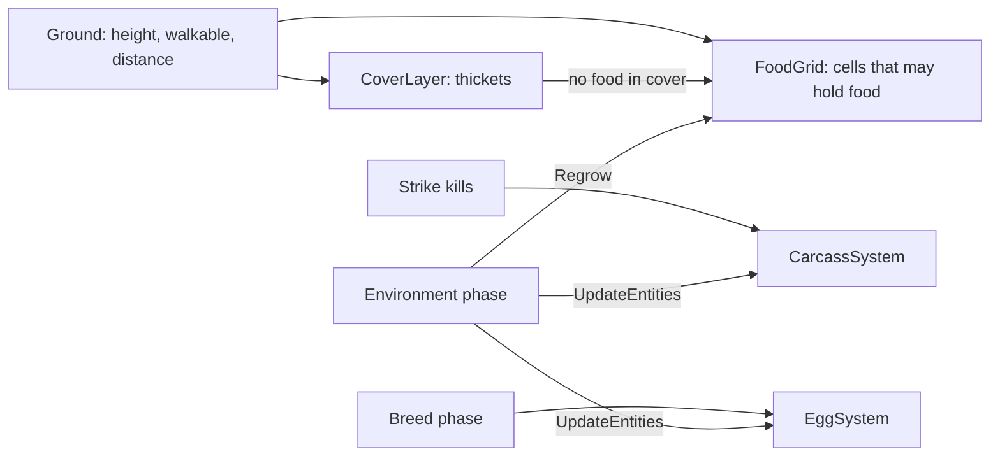

# The environment

Everything in a world that is not an animal is part of the environment: the **ground** animals stand on, the **food**
that grows on it, the **cover** they hide in, and **entities** such as carcasses and eggs. Each is a service, a
component under the World's `Ground` and `Environment` objects. A world may have none, one or several of each kind
(03 — Environment). This page explains the reference modules and their settings.

## How it fits together

1. When the World initialises, the **ground** comes first, since everything else is laid on it. The cover layer then
   builds its map of thickets.
2. Once every module is ready (`Begin`), the food layer picks the cells that may hold food, outside water and cover, and
   places the first items.
3. During a tick, senses and actions query the layers, the cover and the entities. The act phase removes eaten items at
   once, and a successful strike leaves a carcass.
4. In the **environment phase**, the ninth phase of a tick, every resource layer regrows and every entity system ages
   its entities and removes the used-up ones. Nothing else changes the environment.

## The main types

| Type | Role |
|---|---|
| <xref:EvoSim.Ground> | The world rectangle: height and walkability of every point, and the world's distance function |
| <xref:EvoSim.FlatGround> | Lab 1's ground: a flat rectangle, walkable everywhere |
| <xref:EvoSim.TerrainGround> | A Unity Terrain: water, steep slopes and trees are not walkable |
| <xref:EvoSim.ResourceLayer> | Edible items spread over the ground; <xref:EvoSim.FoodGrid> is the reference ("Grass") |
| <xref:EvoSim.Cover> | Places where animals hide from their hunters; <xref:EvoSim.CoverLayer> is the reference ("Thickets") |
| <xref:EvoSim.EntitySystem%601> | Objects with a position that are not animals: <xref:EvoSim.CarcassSystem>, <xref:EvoSim.EggSystem> |
| <xref:EvoSim.Edible> | Makes a species, a layer or an entity kind edible, and says how much energy it gives |
| <xref:EvoSim.EnvironmentPhase> | Regrows the layers and updates the entities, once per tick |

## The ground

The ground answers three questions for any point: its height, whether an animal may stand there, and how far it is
from another point. Distances are measured on the horizontal plane, straight line, in meters (SPACE-02), and every
module measures through [World.Distance](xref:EvoSim.World.Distance(UnityEngine.Vector3,UnityEngine.Vector3)). The
world is a bounded rectangle with hard borders: nothing ever leaves it (SPACE-03).

**FlatGround** is a rectangle from (0, 0) to (`Width`, `Depth`) at height 0, walkable everywhere inside. The reference
sizes are 192 × 192 m (Lab1_Full), 64 m (HideVsFlee) and 48 m (Lab1_Small).

**TerrainGround** reads a Unity Terrain on its GameObject or below it. Walkability is computed once, on a grid of
`Cell Size` meters (1 m), from the centre of each cell:

| Setting | Reference | Effect |
|---|---|---|
| Water Level | set per scene | a cell at or below this world height is water: not walkable |
| Max Steepness | 35° | a steeper cell is not walkable |
| Tree Footprint | 0.5 m | cells around each tree instance are not walkable (0 = trees don't block) |
| Keep Largest Region | on | walkable pockets cut off from the largest region become non-walkable (SPACE-05) |

Heights come from the heightmap itself, not from the grid. A terrain ground also finds water:
[NearestWater](xref:EvoSim.Ground.NearestWater(UnityEngine.Vector3,System.Single)) returns a
<xref:EvoSim.WaterHit> with the water point and a walkable `Shore` point next to it, where a drinking animal stands.

### Moving on the ground

Locomotions never move an animal off walkable ground (MOVE-02). The kinematic locomotion uses two helpers:

- [SlideTo](xref:EvoSim.Ground.SlideTo(UnityEngine.Vector3,UnityEngine.Vector3)) moves in a straight line. If a border,
  water or an obstacle is in the way, it slides along it: it tries the point clamped into the rectangle and the two
  one-axis moves, and keeps the one that gets farthest in the wanted direction. If none gets anywhere, it stops at the
  last walkable point of the line, checked every 0.25 m.
- [SideStep](xref:EvoSim.Ground.SideStep(UnityEngine.Vector3,System.Single,EvoSim.RandomStream)) frees a stuck animal: it
  tries up to 8 random directions, drawn from the species' `actions` stream, and takes the first clear one.

Founders and newcomers are placed at uniformly random walkable points, drawn from the species' `founders` stream.

## Food: resource layers

A resource layer holds edible items. The reference **FoodGrid** keeps at most one item per cell, at the cell centre
(03 §1):

| Setting | Reference | Meaning |
|---|---|---|
| Cell Size | 1 m | the side of a food cell |
| Initial Fraction | 0.1 | share of eligible cells holding an item at the start |
| Regrow P | 0.0015 | probability per empty eligible cell per tick of growing an item: about 670 ticks to regrow an eaten cell |
| No Food In Cover | on | cover cells hold no food at the start and never regrow ("hungry cover", ENV-04) |
| Near Water Bonus | 2 | regrowth multiplier near water (terrain only) |
| Near Water Radius | 3 m | the distance to water that counts as near |

A cell is **eligible** when its centre is walkable and, with hungry cover, outside cover. Food appears uniformly at
random over the eligible cells. The layer's <xref:EvoSim.Edible> gives 25 energy points per item in the reference.

An animal grazes an item when it ends its move within the act phase's `Graze Reach` (0.5 m) of it. Eating removes the
item at once: two animals never eat the same item, and the act order decides who gets a contested one (ENV-02).

Another phase can change how fast food grows: [RegrowFactor](xref:EvoSim.FoodGrid.RegrowFactor) multiplies the
regrowth probability (1 by default). The seasons sample (`Assets/EvoSim/Samples/SeasonsPhase.cs`) sets it to 0.2 in
winter, from a phase placed before the environment phase ([The samples](../extending/samples.md)).

## Cover

The reference **CoverLayer** makes thickets: the top `Fraction` of walkable cells (20 %) of a value-noise map with two
octaves, 8 m and 4 m, on cells of `Cell Size` (1 m). The thickets come in clustered patches. They never change during a
run.

An animal standing in cover is **hidden from the species that hunt it** (ENV-11): its hunters' senses don't report it,
their actions can't target it, and a strike on it fails. Its own species and the species it hunts still see it.
`Hiding Species` limits hiding to a list of species ids (empty = every species).

A world may have several covers: an animal is hidden when any of them hides it, and the hide action runs to the nearest
cover point of any of them. A world without cover behaves as if no point were in cover (ENV-12).

## Entities: carcasses and eggs

An entity is an object with a position that is not an animal (ENV-20). Each has an id, a position and a lifetime in
ticks (-1 = none). Its system removes it in the environment phase once it is used up or its lifetime runs out (ENV-22).

**Carcasses.** When a strike kills, the <xref:EvoSim.CarcassSystem> leaves a carcass at the killed animal's position.
Everything about it comes from the killed species' own <xref:EvoSim.Edible>:

| Edible setting | Reference (prey) | Meaning |
|---|---|---|
| Carcass Portions | 2 | portions, one each for animals other than the killer (0 = no carcass) |
| Carcass Energy | 30 | energy points per portion |
| Carcass Ticks | 100 | ticks before it rots away, eaten or not |

The killer never eats from its own kill, and each eater takes at most one portion. A species eats carcasses when its
diet lists `carcass:<species>`, and finds them with the "Carcass" sense
(<xref:EvoSim.NearestEntitySense>). Its prompt then gets the carcass system's `Prompt Rule`: *"A kill leaves a carcass
that up to {portions} other predators can eat from."*

**Eggs.** Each conception lays one egg per baby in the <xref:EvoSim.EggSystem>. Eggs have no lifetime: they wait for
the hatch phase. With no incubation they hatch in the same tick. In the reference, eggs carry no Edible, so nothing eats
them ([Reproduction and population](reproduction-and-population.md)).

## Random streams

Every draw comes from a named stream (RAND-02). The map uses the **world seed**, everything that happens during the run
uses the **run seed**:

| Stream | Seed | Used for |
|---|---|---|
| `world/<cover name>`, e.g. `world/Thickets` | world | the cover map |
| `world/<layer name>`, e.g. `world/Grass` | world | the first food items |
| `<layer name>`, e.g. `Grass` | run | the layer's regrowth, each tick (ENV-03) |
| `<species>/actions` | run | side steps, strike rolls |
| `<species>/founders` | run | where founders and newcomers appear |

Turn on the World's `Separate World Seed` and set its `World Seed` to keep one map while the run seed varies (RAND-04).
Carcasses, eggs and the terrain ground draw no random numbers.

## In the editor

- The **run views** draw a flat ground with its food and cover cells, and a marker for each entity: a dark red disc per
  carcass, an ivory ball per egg ([Views and real time](views-and-real-time.md)).
- The species inspector lists what a species eats and the energy of each target. *Window ▸ EvoSim ▸ Food Web* shows
  who eats whom ([Editor tooling](editor-tooling.md)).
- Validation reports a fraction outside [0, 1] (V-35), a terrain ground without a terrain (V-20) and diet targets
  without an Edible (V-24).

## Go further

- [Food, cover, entities and ground](../extending/environment.md): write your own layer, cover, entity kind or ground,
  and make anything edible.
- [The food web](food-web.md): diets, threats and who hunts whom.
- [A tick, phase by phase](the-tick.md): where the environment phase sits.
- Specification: [03 — Environment](../spec/03-environment.md), [02 — Space and time](../spec/02-space-and-time.md).
