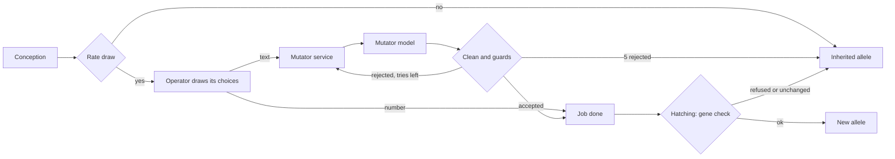

# Genes and mutation

An animal's behaviour comes from its **genes**: short English sentences the brain reads before every decision, and
sometimes numbers that set a trait such as maximum stamina. A baby inherits a mix of its parents' genes, and now and then
one gene **mutates**: a second language model, the **mutator**, rewrites the sentence. Selection does the rest. This page
explains how genes are stored, expressed and changed. How parents and babies meet is in
[Reproduction and population](reproduction-and-population.md).

## Genes, loci and alleles

A gene is a component under a species, a <xref:EvoSim.Gene>. Each gene is one **locus**: one slot in the genome of every
animal of the species. The value an animal carries in that slot is an **allele**. Two animals with the same sentence at
the same gene carry the same allele.

| Gene kind | Holds | Expressed as |
|---|---|---|
| <xref:EvoSim.TextGene> | a sentence, e.g. *"Run from any predator you see."* | a line of the prompt's genes block (GENE-03) |
| <xref:EvoSim.NumberGene> | a number, e.g. 60 | a trait of the animal, e.g. `stamina.max` (GENE-04) |

A text gene placed on an action, or below it, is **bound** to that action and takes its name as label (GENE-05). Each
reference action prefab (`Eat`, `Flee`, `Rest`…) carries its own text gene, so the prey's flee gene is labelled `flee`.
A text gene under no action must have **Free** ticked: it appears under its own label, for a temperament or a general
rule.

The species collects its genes depth first in the hierarchy. That order is the **locus order**
(<xref:EvoSim.Gene.Locus>), the same in every genome. Each gene has a **locus id** `<species id>.<label>`, unique in the
world: `prey.flee`, `predator.hunt` (GENE-11).

## Alleles and the registry

Every allele seen in a run is registered once, in <xref:EvoSim.World.Alleles> (an <xref:EvoSim.AlleleRegistry>, GENE-10).
Sentences are compared after collapsing spaces; numbers at the gene's <xref:EvoSim.Gene.Decimals> (4 by default). Each
<xref:EvoSim.Allele> gets an id `<locus id>:<n>`, counted from 0 per locus: `prey.flee:0`, `prey.flee:1`… It also
records where it came from (GENE-12):

| Field | Example |
|---|---|
| `Origin` | `founder`, `neutral`, `control`, `mutant` |
| `ParentId` | `prey.flee:2`, for a mutant of that allele |
| `Operator` | `llm#5` (instruction 5 of the deck), `gauss` |
| `Model`, `Seed` | `gemma4:26b` and the call's seed, for a sentence written by the mutator |

Following parent ids back from a mutant gives its lineage, down to a founder. The recorder writes every allele to
`alleles.jsonl` ([Recording and outputs](recording-and-outputs.md)).

## Founder pools

Each gene has a **founder pool**, <xref:EvoSim.Gene.FounderPool> (GENE-20). The founders at tick 0, and the newcomers that
arrive below a species' floor, draw each locus independently and uniformly from it.

- A text gene's pool is its founder sentences, plus the **neutral** allele *"No preference."* unless **Has Neutral** is
  off (GENE-24). The reference sentences live in shared <xref:EvoSim.AllelePool> assets, one per locus, in
  `Assets/EvoSim/Data/AllelePools` (`prey_flee.asset`, `predator_hunt.asset`…).
- A number gene's pool is its founder values: 45, 60 and 75 for the reference stamina gene.

Pools are frozen for an experiment (GENE-21): the World registers them before anything else, so founder alleles have the
same ids in every run. Founder sentences pass the same guards as mutants (GENE-22): at most 12 words, ASCII letters,
digits, spaces and `, . ' ’ ; : ! ? -` (<xref:EvoSim.SentenceGuards>).

## Genomes and expression

A <xref:EvoSim.Genome> holds one allele per locus, in locus order (GENE-06). It never changes: a baby gets a new one. Its
<xref:EvoSim.Genome.Key> hashes the species and every allele value (GENE-13); its <xref:EvoSim.Genome.BrainKey> hashes
only the genes the brain reads, and is part of the memo and cache keys (DEC-31).

[Express](xref:EvoSim.Gene.Express(EvoSim.AlleleValue,EvoSim.Expression)) turns an allele into what acts, through an
<xref:EvoSim.Expression>. It runs at two moments:

- **at birth**, a number gene sets its trait, or multiplies the trait's default, clamped to the trait's range;
- **when a decision's prompt is written**, each gene the brain reads adds one line to the genes block (PROMPT-02).

For a reference prey, the genes block looks like this:

```text
- eat: "Eat whenever food is close."
- flee: "Run from any predator you see."
- hide: "No preference."
- follow: "Keep your distance from other animals."
- rest: "Rest only when you feel safe."
- mate: "Mate with any nearby adult."
```

A number gene stays out of the prompt unless its **Show In Prompt** is on.

## Mutation



1. **Which loci.** In the breed phase, after each baby's crossover, each locus mutates with the probability **Rate** of
   its operator: 0.03 per gene per baby (MUT-01). The draw comes from the species' `mutation` stream.
2. **Which operator.** Exactly one <xref:EvoSim.MutationOperator> applies to a locus: the first one that accepts the gene
   and lists it in **Only These**, else the first one that accepts it and lists no gene (MUT-02). The reference uses
   <xref:EvoSim.LlmMutation> for text genes and <xref:EvoSim.GaussianMutation> for number genes.
3. **Draw now.** The operator draws all its random choices at conception (MUT-30) and returns a
   <xref:EvoSim.MutationJob>. A Gaussian job is done at once: v′ = clamp(v + N(0, σ)) within the gene's range, σ = 5
   (MUT-20).
4. **Ask the mutator.** An LLM job goes to the World's <xref:EvoSim.MutatorService>, described below.
5. **Hatch.** The egg hatches once its jobs are done (MUT-32). Each new value must pass the gene's
   [Check](xref:EvoSim.Gene.Check(EvoSim.AlleleValue)); it is then registered as a mutant and listed in the baby's
   `birth` event (MUT-03). A failed job, a refused value or a value equal to the parent leaves the inherited allele
   (MUT-04).

### The LLM mutator

The deck is a text file of instructions, one per line; lines starting with `#` are ignored (MUT-10). The reference deck
`Assets/EvoSim/Data/Decks/mutate_v4.txt` has seven, such as *"Make the rule in this sentence a little weaker."* and
*"Change when this rule applies."*. For each of its 5 tries, `LlmMutation` draws an instruction and a seed at conception.
The prompt is exactly (MUT-11):

```text
The sentence below is a rule that a wild animal follows.
Make this rule say the opposite.

"Run from any predator you see."

Reply with the new sentence only.
```

The mutator sees nothing else: no animal, no world, no other gene (CORE-07).

- **Batches.** The service sends all first tries of a tick as one batch at the end of the breed phase, then the redraws as
  later batches (MUT-31), through the World's <xref:EvoSim.MutatorClient>. The reference client,
  <xref:EvoSim.OllamaMutatorClient>, asks `gemma4:26b` in Ollama (`http://localhost:11434`) on the CPU, so the GPU stays
  the brain's; temperature 1.2, thinking off.
- **Cache.** Answers are stored in the <xref:EvoSim.AnswerCache> under the model, prompt, seed and temperature (MUT-14):
  a repeated run gets the same mutants without a model call.
- **Cleaning and guards** (MUT-12, <xref:EvoSim.MutationText>). The service keeps the quoted part, drops a leading
  "Here is …:", keeps the first sentence, adds a final period and a capital. It rejects the answer as `invalid` (no word,
  more than 12 words, the parent again, a forbidden character) or `unchanged` (only punctuation differs).
- **Redraws.** A rejected try is followed by the next one, with its own instruction and seed (MUT-13). After 5 rejected
  tries the gene stays as it was.
- **No mutator.** If the server can't be reached, the gene stays unchanged (MUT-04). With **Strict** on, the run also
  stops at the end of the tick.

A real mutation: *"Run from any predator you see."* → *"Run quickly from any predator you see."*

### Eggs and waiting

The mutator takes time, so babies wait as **eggs** until their genome is complete. With the reference incubation of 0
ticks, eggs hatch in the tick they are laid, and that tick waits for the mutator's answers. An
<xref:EvoSim.Incubation> of a few ticks lets the world go on while the answers arrive (MUT-33). Either way the result is
the same: every choice was drawn at conception, so it never depends on when an answer comes back.

## The main types

| Type | Role |
|---|---|
| <xref:EvoSim.Gene> | the base class of a locus: label, kind, founder pool, expression, allowed values |
| <xref:EvoSim.TextGene>, <xref:EvoSim.NumberGene> | the reference gene kinds |
| <xref:EvoSim.AllelePool> | an asset of founder and contrast sentences shared by several text genes |
| <xref:EvoSim.Allele>, <xref:EvoSim.AlleleValue> | one registered value with its lineage; the value itself |
| <xref:EvoSim.AlleleRegistry> | every allele of the run, once per locus and value |
| <xref:EvoSim.Genome> | one allele per locus, in locus order |
| <xref:EvoSim.Expression> | what `Express` writes into: a trait, or a prompt line |
| <xref:EvoSim.MutationOperator> | the base class of a mutation rule; <xref:EvoSim.LlmMutation>, <xref:EvoSim.GaussianMutation> |
| <xref:EvoSim.MutationJob> | one mutation of one gene of one baby: done, failed or still running |
| <xref:EvoSim.MutatorService>, <xref:EvoSim.MutatorClient> | batches, cleans and caches LLM mutations; sends the prompts to a server |
| <xref:EvoSim.MutationStats> | the run's counts: attempts, successes, model calls, rejections by reason (MUT-05) |

## Settings

| Component | Field | Reference | Meaning |
|---|---|---|---|
| Text gene | **Pool** | the locus' asset | shared founders; empty = the **Founders** list |
| | **Has Neutral**, **Neutral**, **Neutral Mutates** | on, "No preference.", on | the neutral allele and whether it may mutate (MUT-22) |
| | **Free** | off | not bound to an action |
| | **Max Words** | 12 | word limit for founders and mutants |
| Number gene | **Trait**, **Multiply Default** | `stamina.max`, off | the trait it sets; replace or multiply its default |
| | **Min**, **Max**, **Founders** | 20, 120; 45, 60, 75 | the gene's own range and founder values |
| | **Show In Prompt**, **Decimals** | off, 4 | whether the brain reads it; comparison precision |
| Any operator | **Rate**, **Only These** | 0.03, empty | probability per gene per baby; genes it is configured for |
| LLM mutation | **Deck**, **Context Line**, **Tries**, **Max Words** | `mutate_v4`, the line above, 5, 12 | |
| Gaussian mutation | **Sigma** | 5 | standard deviation, in the gene's unit |
| Mutator service | **Model**, **Temperature**, **Strict**, **Use Cache** | `gemma4:26b`, 1.2, off, on | |

On the World, the controls of [15 — Controls](../spec/15-controls-metrics-and-gates.md) change genes for a whole run:
**No Mutation** (C2) sets every rate to 0; **Shuffled Genes** (C3) makes each decision read the genes of another living
animal of the species; **Random Founders** (C4) draws founder sentences from the World's **Control Sentences** and
founder numbers uniformly in each gene's range.

## In the editor

- The species inspector's **Genes** foldout lists the genes in locus order, with their locus id, kind, founder count
  and the operator that applies, with its rate.
- *Window ▸ EvoSim ▸ Gene Pool*, in Play mode: pick a species and a locus. For a text gene it shows the allele shares over
  time (one colour per allele id), the 12 most common alleles with their text, origin and id, and, when you click one,
  its lineage back to a founder. For a number gene it shows a histogram of the living animals' values. It samples every
  20 ticks while it is open.
- *GameObject ▸ EvoSim ▸ Add Gene ▸ Stamina gene* adds the reference number gene with its Gaussian operator.
- *Assets ▸ Create ▸ EvoSim ▸ Mutation Deck* writes a copy of the reference deck for you to edit.
- Validation reports bad founders (V-40, V-42), empty pools (V-41), a missing neutral allele (V-43), a number gene's
  unknown trait or missing cost (V-45, V-47), a gene no operator accepts (V-48), a missing deck (V-20) or mutator (V-63).

## Go further

- Add a free gene, a number gene or a new gene kind: [Genes](../extending/genes.md).
- Write your own deck or mutation operator: [Mutation](../extending/mutation.md). Rewrite `LlmMutation` from its stub:
  [the teaching path](../extending/exercises.md).
- Use another mutator server: [An HTTP brain or mutator server](../extending/http-brains.md).
- The contract: [09 — Genes, alleles and genomes](../spec/09-genes-alleles-and-genomes.md) and
  [10 — Mutation](../spec/10-mutation.md).
