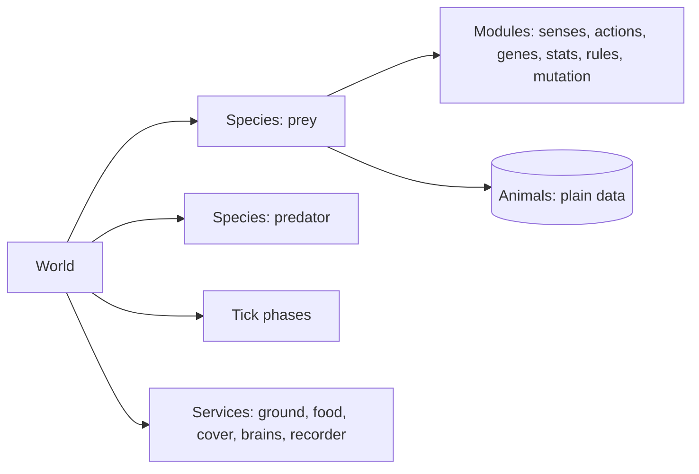
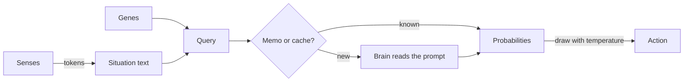

# How EvoSim works

This page is the whole system in one read. Each section links to the guide that explains that part in depth.

## The idea

An animal's behaviour is not coded: it is described by **genes**, short English sentences such as *"Eat whenever you see
grass."* or *"Run from any predator you see."*. At each decision, the animal's **senses** describe its situation in a few
words (*"Food: 1-4 meters away. Predator: none within 20 meters."*). A language model, the **brain**, reads the genes
and the situation and gives a probability for each **action** the species can take: eat, flee, hide, follow, rest,
mate, hunt. The animal draws one action from those probabilities and carries it out for a few ticks.

Animals that eat well and avoid predators live longer and breed more. A baby takes each gene from one parent or the
other, and sometimes a gene **mutates**: a second language model, the **mutator**, rewrites the sentence. Sentences that
help animals survive spread through the population; the others die out. That is evolution, with English as the genetic
code.

## The pieces

- The **World** is a GameObject. Everything else is a component under it, so a scene is a complete experiment.
  ([The world and its modules](world-and-modules.md))
- A **species** is a GameObject under the World. Its child components are its **modules**: senses, actions, genes,
  stats, life rules and mutation operators. Add a component and the species has that feature.
- **Animals** are plain C# objects owned by their species, not GameObjects. Each has a position, stats such as energy
  and stamina, a genome, an age and a current action. ([Animals, stats and death](animals-and-stats.md))
- **Services** are shared parts under the World: the ground, food layers, cover, carcasses and eggs, the brains, the
  mutator, the recorder. ([The environment](environment.md))
- **Tick phases** are components under the World's `Phases` object. The World runs them in hierarchy order, once per
  tick. ([A tick, phase by phase](the-tick.md))

## One tick

Simulation time advances in **ticks**. A tick runs every phase in order:

| Phase | What happens |
|---|---|
| Sense | each animal that decides this tick reads its senses: one token per sense, then its situation text |
| Ask brains | situations already answered come from the memo or the cache; the others go to the brains, one batch per brain |
| Choose actions | the World waits for the answers, then draws each deciding animal's action from its probabilities |
| Act | each action gives an intent (go there, flee from that); the locomotion moves the animal; interactions happen on arrival (graze, strike, scavenge); living costs energy |
| Breed | an animal that chose to mate and reaches a ready partner conceives a litter: one egg per baby, genes crossed over, mutations drawn and sent to the mutator |
| Hatch | eggs due this tick hatch, once their mutated genes are back |
| Deaths | killed animals die; every animal ages by one tick; death rules run (starvation, old age) |
| Migration | species above their cap lose animals chosen at random |
| Environment | food regrows, carcasses rot |
| Floor | species below their floor get newcomers |
| Record | a statistics row every 100 ticks, and the files are flushed; events are written as they happen |

An animal does not decide every tick. In the reference scenes it decides every **4 ticks** (the World's decision
period), and each species' decision schedule staggers its animals by id, so about a quarter of them decide on each
tick and the brain's work is spread out. A newborn decides at once; a busy animal (digesting a kill) does not decide.
Between decisions an animal keeps its action. ([Decisions and brains](brains-and-decisions.md))

## From senses to an action

1. Each **sense** returns one token from a fixed list, for example *here*, *adjacent*, *close*, *medium*, *far* or
   *none* for the nearest food. The tokens together are the animal's **observation**.
   ([Senses and prompts](senses-and-prompts.md))
2. The genes and the situation make a **query**. The brain turns it into a **prompt** from the species' template: a
   header, one line per action, the rules of the world, the animal's genes, the situation text, and the question.
3. The same genes in the same situation always get the same answer from the same brain. The **memo** remembers answers
   during a run and the **answer cache** on disk across runs. Only new questions reach the model.
4. The **brain** returns one probability per action. JEV, a language model served on `localhost:8000`, is the reference
   brain. The random brain answers uniformly and needs no server.
5. The animal **draws** its action, after the probabilities are sharpened or flattened by the sampling temperature.

## From an action to a movement

An action never moves the animal itself. It tells an <xref:EvoSim.ActContext> where to go (*walk to that grass*, *run
away from that predator*) and what to do on arrival (*graze it*, *strike it*). The species' **locomotion** then moves the
animal as far as its speed and stamina allow, and the interaction happens if the target is within reach. ([Actions and
movement](actions-and-movement.md), [The food web](food-web.md))

## From parents to babies

A mating pair produces a **litter**. Each baby takes each gene from one parent or the other (crossover). Each gene then
mutates with a small probability (3 % per gene per birth in the reference). A mutation asks the mutator model to rewrite
the sentence, for example by making it stronger, weaker or about something else. Each baby starts as an **egg** that
carries its genes until the mutator's answers are back. In the reference the incubation is 0 ticks: the eggs hatch in
the same tick, and the tick waits for the mutator if it must. Give a species an incubation of a few ticks and the world
goes on while the mutator works. ([Genes and mutation](genes-and-mutation.md),
[Reproduction and population](reproduction-and-population.md))

## Same seed, same run

Every random draw comes from a named stream derived from the World's seed. As long as the brain answers the same way,
which the memo and the answer cache ensure, a run repeats exactly on the same machine: in the editor, headless, or in a
player build, whatever the speed and the wait mode. Each run ends with an **events hash** that identifies it.
([Determinism and replay](determinism.md))

## What you watch and what you keep

The views only display: bodies follow their animals, with a marker coloured by their action, over a ground painted with
food and cover. The recorder writes every event and statistic to `Logs/EvoSim/runs/`. ([Views and real time](views-and-real-time.md),
[Recording and outputs](recording-and-outputs.md))
