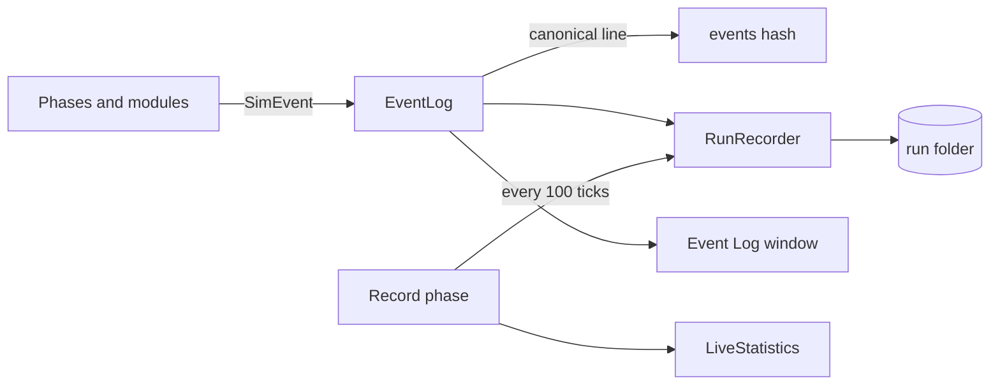

# Recording and outputs

A run writes enough to rebuild its whole gene history afterwards: every founder, birth and death with its genome and
cause, statistics over time, every allele ever seen, and what was configured. The files follow the Python prototype's
formats, so its analysis tools can read Unity runs (13 — Outputs and recording). Each run also ends with an **events
hash**, a fingerprint that tells you whether two runs were identical.

## How it works



1. Code that changes the world records what happened as a <xref:EvoSim.SimEvent>: a kind, the tick, the animal's id,
   its species and more fields. It goes to the World's <xref:EvoSim.EventLog> (`World.Events`).
2. The event log writes the event as **canonical JSON**: keys sorted, numbers rounded to at most 6 decimals, separators
   as Python writes them (<xref:EvoSim.CanonicalJson>). It adds that line to the running hash, then passes the event to
   every listener (an <xref:EvoSim.IEventSink>): the <xref:EvoSim.RunRecorder>, the Event Log window, tests.
3. The **record phase**, last in the tick, asks the recorder for a statistics row every `Stats Every` ticks and lets it
   flush its files. It also samples the <xref:EvoSim.LiveStatistics> for the editor's graphs.
4. When the run stops, for any reason (tick limit, stop button, leaving Play mode, a brain failure), the recorder writes
   its final files. A stopped run always has complete files (RAND-20).

## The events hash

The hash is a chain of SHA-256 digests. It starts from a hash of the run seed and the world seed, so two seeds never
share a hash. Then each event's canonical line is hashed together with the previous hash (RAND-10). The hash can be read
after any event: `World.Events.Hash` (64 hex digits) or `World.Events.ShortHash` (the first 16).

The same scene, seeds and answer caches give the same hash, whatever the wait mode, frame rate, run speed or views
(RAND-11). A different hash means something in the run changed. Compare hashes on one machine only: floating-point
results may differ between machines (RAND-12). See [Determinism and replay](determinism.md).

## The run folder

The recorder writes each run into its own folder (OUT-01): `<Output Root>/<Run Name>`. By default
`Logs/EvoSim/runs/<world>-s<seed>-<date>-<time>`, for example `Logs/EvoSim/runs/Lab1_World-s1234-20261011-143005`.
Characters other than letters, digits, `-`, `_` and `.` become `_`. If the folder exists already, a suffix `-2`, `-3`…
is added. Paths are relative to the project folder in the editor, and to the build's folder in a player.

| File | Written | What you find there |
|---|---|---|
| `events.jsonl` | as events happen, flushed every 500 ticks | one event per line, in tick order ([Events](#events)) |
| `stats.csv` | a row every 100 ticks, flushed every 500 | populations, means and cumulative counters per species |
| `alleles.jsonl` | rewritten every 5 000 ticks and at the end | every allele seen: `id`, `locus`, `text` (or `value`), `origin` (`founder`, `neutral`, `mutant`), `parent_id`, `operator`, `model`, `seed` |
| `final_population.json` | at the end | the living animals: `id`, `gen`, `genome` (allele ids), `species` |
| `summary.json` | at the end | totals per species and for the run ([Summary](#summary)) |
| `run_info.json` | at the start, again at the end | what ran: scene, seeds, settings, brains, git commit ([Run information](#run-information)) |

### Events

Every event has `kind`, `t` (the tick) and `species`, and `id` when it is about an animal (OUT-02):

| Kind | Fields |
|---|---|
| `founder` | `genome`: the animal's allele ids, in locus order |
| `immigrant` | `genome`: a newcomer added below the species' floor |
| `birth` | `parents`, `gen`, `genome`, `litter` (its litter's size), `mutations` (a list of `locus`, `parent`, `child`, `prompt` or `operator`, `text` or `value`); `laid` (the conception tick) when it hatched from an incubated egg |
| `death` | `cause` (`killed`, `starvation`, `old_age`, `migrated`, or a module's own), `age`, `gen`, `food` (meals eaten), `offspring`, and `killer` for a kill |
| `egg_lost` | `id` of the egg, `parents`, `reason` (`eaten`) |
| `species_created` | `name`, `parent_species`: a species added during the run |

For example, a death line looks like this:

```json
{"age": 412, "cause": "killed", "food": 9, "gen": 2, "id": 1873, "killer": 1702, "kind": "death", "offspring": 3, "species": "prey", "t": 5120}
```

Allele ids read `<locus>:<n>`, and a locus is `<species>.<gene label>`: `prey.eat:3` is the fourth allele of the prey's
`eat` gene.

### Statistics

`stats.csv` has one row every `Stats Every` ticks (100), labelled with the number of ticks done: rows `t = 100, 200…`.
After `t`, each species has a block of columns prefixed with its id (`prey_pop`, `predator_pop`):

| Column | Meaning |
|---|---|
| `pop` | living animals |
| `mean_energy`, `mean_stamina`, `mean_gen` | means over the living animals |
| `max_gen` | the highest generation alive |
| `exhausted` | animal-ticks that began without stamina to move |
| `births`, `immigrants` | cumulative |
| `deaths_starve`, `deaths_pred`, `deaths_age`, `deaths_migrated` | cumulative deaths by cause (`deaths_pred` counts kills) |
| `deaths_<cause>` | one more column per other cause: a death rule's, or any recorded by a module |
| `decisions`, `backend_queries`, `invalid` | cumulative decisions, decisions the memo could not answer, searching choices |
| `portions` | carcass portions eaten |
| `act_<action>` | cumulative decisions per action |

Modules add their own columns after the species' block ([Recording and statistics](../extending/recording.md)). A
column `alleles` (all alleles registered) follows the first species, and world modules' columns end the row. Counters
are cumulative from the start of the run. If a column appears during the run (a species added, a new cause of death),
the file is rewritten with the new header, and older rows get empty cells in it.

### Summary

`summary.json` has, for the run: `ticks`, `seed`, `world_seed`, `backend` (the default brain), `brains`, `mutations`
(tried, ok, calls, failed, rejected by reason), `alleles`, `events` (how many), `events_hash` and `events_sha` (its first
16 digits), `stopped` (why the run stopped), `minutes`, `llm_calls`, `cache_hits`, `failures`, `mutation_calls`. Under
`species`, each species has its final population, births, newcomers, hatched eggs, deaths by cause, mean lifespan,
maximum generation, decisions, brain queries, memo hit rate, brain time (`backend_s`), searching rate (`invalid_rate`),
share of exhausted animal-ticks, share of each action, founders, lost eggs, failures, and for hunters kills and
portions (13 §5).

### Run information

`run_info.json` says what ran (CFG-03): the World's name, `scene`, Unity version, `git` commit, `seed` and
`world_seed`, wait mode, act order, decision period, sampling temperature, text style, the default brain, the command
line, the start time, the controls (`no_mutation`, `shuffled`…), each brain's model, the mutator's model and
temperature, and `settings`: every serialized setting of every enabled module under the World, by path, for example
`"Environment/Grass/FoodGrid/regrowP": 0.0015`. A scenario run adds `scenario`, `variant` and `overrides`. No API key
or other secret is ever written: options that name a key are masked in the command line (OUT-04).

## Settings

On the World's `Recording` object:

| Component | Setting | Reference | Meaning |
|---|---|---|---|
| RunRecorder | Output Root | `Logs/EvoSim/runs` | the folder that receives one folder per run |
| | Run Name | empty | the run folder's name; empty = world, seed, date; `{world}` and `{seed}` are replaced |
| | Stats Every | 100 ticks | a statistics row every this many ticks |
| | Flush Every | 500 ticks | events and statistics reach the disk at least this often |
| | Alleles Every | 5 000 ticks | `alleles.jsonl` is rewritten this often |
| | Compatibility | off | write a two-species world as the prototype did (below) |
| | Write Files | on | off: no files, only the hash and the counters (tests) |
| LiveStatistics | Every | 10 ticks | a sample for the editor's graphs this often |
| | Capacity | 2 000 | samples kept per species; older ones are dropped |

A world without a recorder still computes its events hash. Validation warns when there is a recorder and no record
phase (V-09).

### Compatibility mode

With `Compatibility` on, a two-species world is written exactly as the prototype wrote it (OUT-05), so its tools
(`gene_report`, `gene_timeline`, `mutation_list`) read it: the first species' events have no `species` field and its
allele and locus ids no prefix (`eat:3`); its statistics columns have no prefix and the second species' have `pred_`;
a kill's cause is `predator`; the summary puts the first species' totals at the top level and the second species' under
`<id>s` (`predators`). Only the files change: the events hash is the same in both modes.

## Scenarios and field paths

A **scenario** runs a scene with changed settings, without editing the scene (CFG-02, 31 — Scenarios). It is a
<xref:EvoSim.ScenarioAsset> (*Assets ▸ Create ▸ EvoSim ▸ Scenario*), kept in `Assets/EvoSim/Scenarios`:

| Field | Meaning |
|---|---|
| Title | its id and title, e.g. "S07 No cover" |
| Scene | the scene, e.g. `Assets/EvoSim/Scenes/Lab1_Full.unity` |
| Set | overrides applied to every variant: a path and a value |
| Variants | each with a `Name`, its own `Brain` and `Tier`, more overrides (`Set`, applied after the scenario's) and GameObjects to switch off (`Remove`) |
| Seeds | one run per seed |
| Ticks | the run length |
| Brain | the default brain, by GameObject name or brain id; empty = the scene's |
| Expect | what the scenario should show, as notes for the reader |
| Tier | T2 (fast), T3 (regression), T4 (real models) |

An override names a setting by its **field path**, relative to the World:
`<GameObject path>/<Component>/<field>` (<xref:EvoSim.FieldPath>). Names are matched in any case, a species also by its
id or display name, and the component is found on the GameObject or anywhere below it, so `Prey/Litter/max` works
although the Litter sits under `Prey/Life`. `World/<field>` is the World's own setting, such as `World/decisionPeriod`.
Values are text: `2`, `0.5`, `true`, an enum name such as `Block`, `[8, 4]` for a list of numbers. Only fields the
Inspector shows can be set. The keys of `run_info.json`'s `settings` are valid paths: copy one to override it.

Two real examples: S20 sets `Prey/CapRule/mode` to `Migrate` in one variant and `Block` in the other. S07 removes
`Environment/Thickets`, `Prey/Actions/hide` and `Prey/Senses/Cover` to run the reference world without cover.

Run a scenario from *Window ▸ EvoSim ▸ Scenario Runner*, in Edit mode with the scenario's scene closed: pick a variant,
seeds and a length, and press `Run`. *Run each seed twice and compare the hashes* checks that the scenario is
deterministic. In batch mode:

```
Unity.exe -batchmode -nographics -projectPath . -executeMethod EvoSim.Batch.RunScenario -scenario S03 [-variant name] [-seed n] [-ticks n]
```

A scenario run's folder is named `<scenario>-<variant>-s<seed>-<time>`. A path or value that can't be applied stops the
run before it starts, with a message naming it. Overrides skip the Inspector's limits; validation still reports values
out of range (V-35).

## In the editor

- *Window ▸ EvoSim ▸ Event Log* lists the running world's events as they are recorded, filtered by kind, species or
  animal.
- *Window ▸ EvoSim ▸ Ecology Monitor* draws each species' population over time from the LiveStatistics, with the
  ticks per second, and lists each species' counters: births, deaths by cause, decisions, memo hits, action shares.
- The run views' overlay shows the tick, the pace, and each species' population, births and deaths on screen, in the
  editor and in a build ([Views and real time](views-and-real-time.md)).

## Go further

- [Recording and statistics](../extending/recording.md): add statistics columns, causes of death, events of your own.
- [Determinism and replay](determinism.md): random streams, the answer cache and resuming a run.
- [Running and building](running-and-building.md): headless runs and the player's command line.
- Specification: [13 — Outputs and recording](../spec/13-outputs-and-recording.md),
  [14 — Configuration reference](../spec/14-configuration-reference.md), [31 — Scenarios](../spec/31-scenarios.md).
