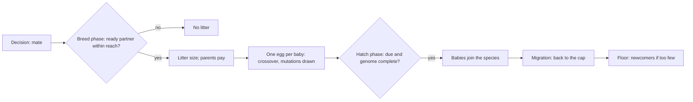

# Reproduction and population

Evolution needs births: an animal that eats well, escapes predators and finds a partner leaves babies, and its genes
spread. This page follows a birth from the mate decision to the newborn, then explains the limits that keep each
population in bounds: a cap above, a floor below. What happens to the genes on the way, mutation in particular, is in
[Genes and mutation](genes-and-mutation.md).

## How a birth happens

### Mating

An animal whose brain chose *mate* walks toward the nearest ready partner it sees. The breeding itself happens in the
**breed phase**, after every animal has acted (TICK-06):

1. The phase takes, in id order, each animal whose current action is mate, that is **ready** and hasn't bred in this
   decision period. Ready means alive, adult (age at least the **Maturity** trait, 150 ticks) and with at least
   **Mate Energy** (50 points) (<xref:EvoSim.MatingRule.IsReady(EvoSim.Animal)>, REPRO-01).
2. It pairs it with the nearest ready animal of its species within **Reach** (1 m) that hasn't bred either; ties go to
   the lower id. **One partner's choice is enough**: the partner may be resting or eating (REPRO-02).
3. Both are marked as having bred. Each animal breeds at most once per decision period: the mark is cleared at its next
   decision (REPRO-03).

With **Sexual** off on the <xref:EvoSim.MatingRule>, or the World's **Asexual** control (C7) on, a ready animal that
chose mate reproduces alone and pays the whole cost (REPRO-04). Killed animals never breed (REPRO-05).

### Litters and their cost

The <xref:EvoSim.Litter> decides how many babies a mating makes (REPRO-10):

1. k is drawn uniformly in [**Min**, **Max**] = [2, 4], from the species' `litter` stream.
2. Each baby costs **Child Energy** (40 points), shared equally by the parents: with two parents, 20 each per baby.
3. k is cut so that no parent pays more energy than it has, but **never below Min**. A poor parent can be left with zero
   energy or less, and starves at the death check. This is a choice of the contract, not an accident.

Each parent then pays its share × k, its offspring counter grows by k, and it is marked as having bred (REPRO-11). With
the reference values, a parent at 50 energy pays for 2 babies (40 points) and keeps 10; at 100 it can pay for 4.

### Crossover and eggs

Each baby gets its **own** crossover, so siblings usually differ (GENE-32). The reference <xref:EvoSim.UniformCrossover>
takes each locus from one parent or the other with probability ½, independently, from the species' `mutation` stream
(GENE-30). A baby of a single parent copies its genome (GENE-31). The baby's mutations are then drawn, locus by locus
(MUT-30).

Each baby becomes an <xref:EvoSim.Egg>, laid at the first parent's position in the World's <xref:EvoSim.EggSystem>
(REPRO-20). An egg holds the parents, the generation (the larger parent generation + 1), the alleles after crossover, the
mutations still running, the conception tick and the hatch tick: conception + the species' <xref:EvoSim.Incubation>
**Ticks**. Eggs are not animals: they don't sense, decide, move, eat, breed or count toward caps (REPRO-22). In the
reference nothing eats them; a species can be given a taste for eggs (REPRO-23, see
[Reproduction and population](../extending/reproduction.md#eggs-as-food)).

### Hatching

The **hatch phase** runs right after the breed phase. Eggs due at this tick hatch in conception order (REPRO-22), but
only once their genome is complete: if the mutator's answers aren't in, the tick waits (MUT-32, REPRO-24). With the
reference incubation of 0 ticks, babies hatch in the tick they were conceived, as in the prototype (REPRO-21).

Each baby starts with the litter's **Child Energy**, full stamina, age 0, the heading drawn at conception, at the egg's
place (REPRO-12). It has no action until its first decision, at the start of the next tick (REPRO-13). A `birth` event
records its parents, generation, genome, litter size and mutations.

## Caps and migration

Each species has a <xref:EvoSim.CapRule> with a **Cap** and a **Mode** (POP-01):

| Mode | At the cap |
|---|---|
| **Migrate** (reference) | Births go on. In the **migration phase**, if the species is above its cap, animals chosen uniformly at random leave the world (death cause `migrated`) until it is back at the cap. Animals born this tick are spared, unless too few older animals remain. |
| **Block** | No conception while the species is at or above its cap; a litter is cut to the places left, possibly to zero. |

Migration draws from the species' own `migration` stream and ignores genes, stats and position, so it favours no gene
(POP-02). Migrate was chosen over Block because blocked births led to boom-and-bust crashes (11 §4).

## Floors and newcomers

Each species has a <xref:EvoSim.FloorRule>. In the **floor phase**, the last but one phase of the tick, while a species has
fewer living animals than its **Floor**, a **newcomer** arrives (POP-03): a founder genome drawn from the founder pools,
a random walkable position, the starting stats, generation 0, recorded as an `immigrant` event. It decides from the next
tick (TICK-05). At tick 0 each species gets its **Initial Population** of founders the same way, recorded as `founder`
events (POP-04).

Newcomers bring founder genes back and restart that species' evolution, so a run that needs them is reported (POP-05).
The aim is a world that never needs them: litters of 2 to 4 and migration at the cap made both reference species last
without newcomers.

## The main types

| Type | Role |
|---|---|
| <xref:EvoSim.MatingRule> | who is adult and ready, the breeding reach, one or two parents |
| <xref:EvoSim.Litter> | the litter size and the energy each baby costs |
| <xref:EvoSim.Crossover>, <xref:EvoSim.UniformCrossover> | how the parents' genomes mix |
| <xref:EvoSim.Incubation> | ticks from conception to hatching |
| <xref:EvoSim.Egg>, <xref:EvoSim.EggSystem> | a conceived baby; the world's eggs, laid and hatched in order |
| <xref:EvoSim.CapRule>, <xref:EvoSim.FloorRule> | the population's upper and lower limits |
| <xref:EvoSim.BreedPhase>, <xref:EvoSim.HatchPhase> | the phases that conceive and hatch |
| <xref:EvoSim.MigrationPhase>, <xref:EvoSim.FloorPhase> | the phases that apply the cap and the floor |

## Settings

The rules sit in each species' `Life` group; the egg system is the World's `Environment ▸ Eggs` object.

| Component | Field | Reference | Meaning |
|---|---|---|---|
| Mating rule | **Mate Energy** | 50 points | energy needed to be ready |
| | **Maturity** | 150 ticks | adult age; a trait, so a number gene could set it |
| | **Reach** | 1 m | breeding distance |
| | **Sexual** | on | two parents; off = one parent pays all |
| | **Prompt Rule** | "Breeding needs only one of the two to choose mate…" | the rule line the brain reads |
| Litter | **Min**, **Max** | 2, 4 | litter size range, in babies |
| | **Child Energy** | 40 points | each baby's energy, paid by the parents |
| Incubation | **Ticks** | 0 | conception to hatching |
| Cap rule | **Cap** | prey 270, predators 68 (`Lab1_Small`: 40 and 6) | maximum population, in animals |
| | **Mode** | Migrate | Migrate or Block |
| Floor rule | **Floor** | prey 10, predators 3 | minimum population, in animals |
| Species | **Initial Population** | prey 136, predators 28 (`Lab1_Small`: 24 and 4) | founders at tick 0 |

## In the editor

- The species inspector's **Population** foldout shows the initial population, the floor, the cap and its mode, and the
  living count in Play mode.
- In Play mode, the Scene view's EvoSim overlay draws a yellow circle under each egg (the **Eggs** toggle).
- *Window ▸ EvoSim ▸ Event Log* lists `birth`, `immigrant`, `egg_lost` and `death` events as they happen; filter by kind,
  species or animal, and follow one animal's descendants.
- *Window ▸ EvoSim ▸ Ecology Monitor* graphs the populations and counts births, founders and deaths by cause.
- Validation warns about a breeding species without an `EggSystem` (V-20), without a `Litter`, a crossover or an
  `Energy` module (V-26), a floor or initial population above the cap (V-32), a bad litter range (V-33), and a smallest
  litter that costs more than the mate energy (V-34).

## Go further

- Change who mates, how genes mix, litter sizes, incubation, caps or floors:
  [Reproduction and population](../extending/reproduction.md).
- Rewrite `Litter` and `UniformCrossover` from their stubs: [the teaching path](../extending/exercises.md).
- The contract: [11 — Reproduction and population](../spec/11-reproduction-and-population.md); the phase order:
  [A tick, phase by phase](the-tick.md).
