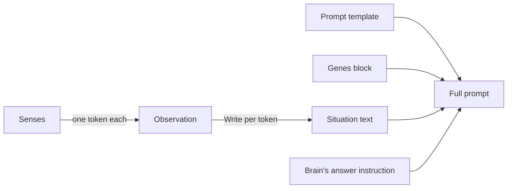

# Senses and prompts

A brain never sees the world. It reads a few words about it. At each decision, every **sense** of the animal's species
turns one aspect of the world (the nearest food, the energy level) into one **token** from a short, fixed list. The
tokens together are the animal's **observation**, and the species writes them as a **situation text** such as
*"Energy: low. Food: 1-4 meters away."*. The species then puts that text into its **prompt**, with the rules of the
world and the animal's genes. Discrete tokens keep the prompt short and let identical situations be answered once
([06 — Senses](../spec/06-senses-and-observations.md)).

## How it works



1. The sense phase picks the animals that decide this tick ([Decisions and brains](brains-and-decisions.md)).
2. It casts the rays of the batched senses, then calls every sense of every deciding animal. Each sense returns an index
   into its token list (SENSE-01).
3. The indices, in sense order, make an <xref:EvoSim.Observation> (SENSE-02).
   <xref:EvoSim.Species.Describe(EvoSim.Observation,EvoSim.TextStyle)> has each sense write its token and joins the
   fragments with spaces: the situation text (SENSE-10).
4. A brain that reads text fills the species' prompt template, built when the run started, with the animal's genes,
   the situation text and its own answer instruction ([Prompt](xref:EvoSim.DecisionQuery.Prompt(EvoSim.Brain))).

## Senses and tokens

| Type | Role |
|---|---|
| <xref:EvoSim.Sense> | reads one animal and returns one token from its fixed <xref:EvoSim.Sense.Tokens> list |
| <xref:EvoSim.BandedSense> | a sense of distance, in bands: "here", "adjacent" … "far", "none" |
| <xref:EvoSim.BatchedSense> | a sense that casts rays, all in one batch per tick |
| <xref:EvoSim.SenseContext> | what a sense may read: the state at the start of the tick, through the same queries as actions |
| <xref:EvoSim.Observation> | one token index per sense, in sense order |
| <xref:EvoSim.ObservationView> | an observation read by sense label, as actions do in `IsRelevant` |

The senses' depth-first order under the species is the order of the tokens in the observation and of the fragments in
the situation text. Each sense has a **Label** ("Food", "Predator"), which starts its V1 fragment; two senses of one
species can't share a label (V-17). A sense sees the world as it was at the start of the tick (SENSE-04), and never an
animal hidden from it in cover nor one killed this tick (SENSE-06).

The number of possible observations is the product of the token counts (SENSE-05). The species inspector shows it as
**Observation space**. Validation warns above 100 000 (V-50), because the memo and the answer cache then rarely help.

## The reference senses

| Label | Class | Tokens | Rule |
|---|---|---|---|
| Energy | <xref:EvoSim.LevelSense> | low, medium, high | low below 30, high above 70 |
| Stamina | <xref:EvoSim.LevelSense> | low, medium, high | prey 20 / 40, predators 10 / 20 |
| Food | <xref:EvoSim.NearestResourceSense> | here, adjacent, close, medium, far, none | nearest item of a layer the diet grazes; "here" within the 0.5 m graze reach |
| Predator | <xref:EvoSim.NearestAnimalSense> (threats) | adjacent, close, medium, far, none | nearest animal of a species whose diet strikes this one |
| Prey | <xref:EvoSim.NearestAnimalSense> (prey) | adjacent, close, medium, far, none | nearest animal of a species this one strikes |
| Cover | <xref:EvoSim.NearestCoverSense> | here, adjacent, close, medium, far, none | "here" when standing in cover |
| Carcass | <xref:EvoSim.NearestEntitySense> | adjacent, close, medium, far, none | nearest carcass it may eat: portions left, not its own kill, not eaten from yet |
| Animal, Other predator | <xref:EvoSim.NearestAnimalSense> (kin, readiness on) | 4 bands × (ready, not ready), none | readiness is seen within the **Partner Range**, 20 m |
| Age | <xref:EvoSim.AgeSense> | young, adult | adult from the "maturity" trait, 150 ticks |

The reference prey has Energy, Stamina, Food, Predator, Cover, Animal and Age: 29 160 possible observations. The
reference predator has Energy, Stamina, Prey, Carcass, Other predator and Age: 4 050. *GameObject ▸ EvoSim ▸ Add Sense*
adds any of them to the selected species, from the prefabs in `Assets/EvoSim/Modules/Senses`.

## Distance bands

A <xref:EvoSim.BandedSense> turns a distance into a band (SENSE-20). Its **Bands** setting (<xref:EvoSim.Bands>) holds
the edges 1, 4 and 10 m and a vision of 20 m:

| Token | Distance | V1 text |
|---|---|---|
| here (food, cover) | within reach, or standing in it | Food: here. |
| adjacent | ≤ 1 m | Food: within 1 meter. |
| close | 1–4 m | Food: 1-4 meters away. |
| medium | 4–10 m | Food: 4-10 meters away. |
| far | 10–20 m | Food: 10-20 meters away. |
| none | nothing within the vision | Food: none within 20 meters. |

Vision is a **trait**, "vision", so a number gene can change it (SENSE-22). The sense reads each animal's own vision
when it looks. The texts state the trait's default, so one token always gives one text. Band edges must be positive,
increasing and below the vision (SENSE-21, V-30).

## Situation texts: V1 and V2

The World's **Text Style** chooses how every sense writes (SENSE-11). **V1** is terse, **V2** is first person. The
reference uses V1. The same prey situation in both styles:

```text
V1: Energy: low. Stamina: high. Food: 1-4 meters away. Predator: 4-10 meters away. Cover: here.
    Animal: 10-20 meters away, ready to mate. Age: adult.

V2: I am hungry and weak. I am rested. The nearest food is 1-4 meters away. The nearest predator is 4-10 meters away.
    I am in cover. The nearest other animal is 10-20 meters away. It is ready to mate. I am an adult.
```

A text depends on the token only, never on the animal: the same observation always gives the same text (SENSE-10).
The answer cache relies on it. Distances always say "meters" (SENSE-13). A level sense takes its V2 sentences from its
**Words** field. A banded sense builds them from its **Noun** ("food", "other animal").

## Batched raycasts

A sense that needs line of sight or the terrain ahead derives from <xref:EvoSim.BatchedSense>. It asks for its rays in
<xref:EvoSim.BatchedSense.RequestRays(EvoSim.Animal,EvoSim.RayBatch)>. The sense phase casts the rays of every deciding
animal in one batch (SENSE-30), then the sense reads its results through <xref:EvoSim.SenseContext.Rays>. The tokens
must be the same as when rays are cast one at a time (SENSE-31). Rays never hit the views, so what an animal senses never
depends on rendering (RAND-11). No reference sense casts rays; the test sense <xref:EvoSim.Testing.ObstacleSense> does.

## Attachments

A sense may also attach an object to the query, such as a small camera image, for a brain that reads images (SENSE-40).
A query with an attachment is memoised and cached only if the sense gives a key for it (SENSE-41). The species' brain
must accept attachments (V-51). No reference brain does. See [A sense](../extending/sense.md#attachments).

## How the prompt is written

When the run starts, <xref:EvoSim.PromptWriter.Build(EvoSim.Species)> writes each species' prompt template
(<xref:EvoSim.Species.Prompt>), in this order (PROMPT-01):

| Part | Comes from |
|---|---|
| Header | the species' **Prompt Header** ("You decide what a wild animal does next in a simple world.") |
| `Actions:` and one line per action, in action order | each action's **Description**: `- eat: go to the nearest visible food and eat it` |
| Rule lines | the engine's line for actions done in passing, first, when the species has any (ACT-07, PROMPT-03): *Some actions are done in passing (alarm): the animal also does its next most likely choice.*; then every species module's `WritePromptRules` (search rule, locomotion, stamina, mating), then every world service's (the carcass line) |
| Genes intro | the species' **Genes Intro** ("This animal's instincts (its genes)…") |
| `{genes}` | one line per gene the brain reads, in locus order: `- eat: "Eat whenever food is close."` (PROMPT-02) |
| `Situation: {situation}` | the situation text |
| `{ask}` | the brain's <xref:EvoSim.Brain.AnswerInstruction>, hard-coded in the brain because its parsing depends on it (PROMPT-07) |

The reference prey's prompt, for a founder in one situation, with the Ollama points brain (shortened):

```text
You decide what a wild animal does next in a simple world.

Actions:
- eat: go to the nearest visible food and eat it
- flee: run away from the nearest predator
- hide: go to the nearest cover and stay in it; predators can't see or catch an animal in cover
…
Animals move 1 meter per step. Predators run 2 meters per step when they hunt,
but they have 30 stamina against an animal's 60, so a long chase tires them first.
…
This animal's instincts (its genes). They define its personality: follow them
even when they seem unwise. Instincts that are meaningless have no effect.
- eat: "Eat whenever food is close."
- flee: "Run from any predator you see."
…
Situation: Energy: low. Stamina: high. Food: 1-4 meters away. Predator: 4-10 meters away. Cover: 1-4 meters away. Animal: none within 20 meters. Age: adult.

Distribute 100 points across the actions according to how likely this animal is to choose each.
```

JEV adds no instruction: it sends this text without its last line, followed by its own question and the actions as
lettered options. The template's <xref:EvoSim.PromptTemplate.Id> is a hash of its text. It is part of the answer
cache's keys, so editing a header, a description or a rule line asks the model again (PROMPT-05).

## Placeholders

Numbers in descriptions and rule lines come from the modules' settings, so the prompt never contradicts the world
(PROMPT-03). The speed line above is written `Animals move {walkSpeed} meter per step. Predators run
{predator.Locomotion.runSpeed} meters per step…`.

| Placeholder | Reads |
|---|---|
| `{field}` | a field or property of the module writing the line: `{walkSpeed}` |
| `{Module.field}` | another module of the same species, named by its class, a base class or its GameObject: `{Stamina.max}` |
| `{species.Module.field}` | a module of another species: `{predator.Stamina.max}` |
| `{name}` | this species' display name |
| `{species.name}`, `{species.id}` | another species' display name or id |
| `{{` and `}}` | a literal brace |

A field can be public or private. Numbers are written as the brain reads them ("4", "2.5"), booleans as "yes" or "no".
An unknown placeholder stays in the text and validation reports it (V-53). The header and the genes intro have no
writing module, so only `{name}` and the dotted forms work there.

## Frozen prompts

A species can use a fixed text instead of the assembled one: set its **Frozen Prompt** to a text asset that contains
`{genes}`, `{situation}` and `{ask}` (PROMPT-04). The prototype's prompts in [08 §7](../spec/08-decisions-brains-and-prompts.md)
are examples. Placeholders in it are still filled. A missing hole is reported (V-53).

## Settings

| Where | Field | Reference | Effect |
|---|---|---|---|
| World | **Text Style** | V1 | V1 or V2 situation texts, for every species |
| Species | **Prompt Header**, **Genes Intro** | see above | the fixed parts of the prompt |
| Species | **Frozen Prompt** | none | replaces the assembled prompt |
| Any sense | **Label** | empty = the sense's default | the name the brain reads; must be unique in the species |
| Banded sense | **Bands** (Edges, Names, Vision), **Noun** | 1, 4, 10 m; vision 20 m | the bands, and the noun of V2 texts |
| Level sense | **Stat**, **Low**, **High**, **Words** | energy 30 / 70 | which stat, the thresholds, the V2 sentences |
| Nearest animal sense | **Targets**, **Listed**, **Report Readiness**, **Partner Range** | threats; readiness off; 20 m | which animals, and whether readiness is written |
| Action | **Description** | per action | its line in the prompt |

## In the editor

- Select a **species**. In Edit mode, press **Show the computed tables**. The inspector lists the senses in
  situation-text order, with their tokens and the V1 and V2 texts of the first token. It also shows the
  **Observation space** and the **Signature**, which changes when a sense is added, removed, renamed or moved (V-12).
- Its **Prompt preview** builds the exact text a brain receives. Pick a **Brain**, a **Founder genome**, a **Text style**
  and one token per sense (or **Random situation**), then press **Build**. It shows the estimated token count and the
  brain's limit; **Copy** puts the text on the clipboard.
- *Window ▸ EvoSim ▸ Animal Inspector* shows the last situation text of the selected animal.
- *Window ▸ EvoSim ▸ Ask the Brain* asks brains about a genome and a situation of your choice.

## Go further

- [A sense](../extending/sense.md): write your own sense, banded or batched.
- [Decisions and brains](brains-and-decisions.md): what happens to the observation and the prompt next.
- [Species modules](../extending/species-modules.md): `WritePromptRules`, for rule lines of your own modules.
- API: <xref:EvoSim.Sense>, <xref:EvoSim.SenseContext>, <xref:EvoSim.Bands>, <xref:EvoSim.PromptWriter>,
  <xref:EvoSim.PromptTemplate>, <xref:EvoSim.Editor.SpeciesInspector>.
- Specification: [06 — Senses and observations](../spec/06-senses-and-observations.md),
  [08 — Decisions, brains and prompts](../spec/08-decisions-brains-and-prompts.md) §7.
