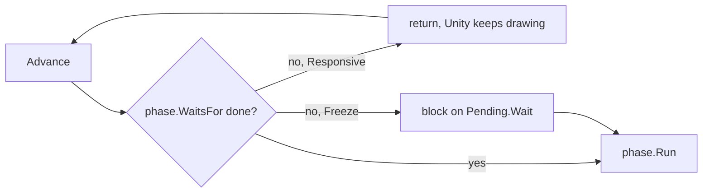

# A tick, phase by phase

Simulation time is counted in **ticks**, not seconds (SPACE-10). A tick runs every <xref:EvoSim.TickPhase> of the World
once, in hierarchy order (TICK-01). Unity's frame loop only decides how many ticks run per frame: what happens in a tick,
and the result of a run, never depend on it. This page follows one tick, then explains how the World waits for the brain,
when a run stops, and how births and deaths happen inside a tick.

## The reference phases

The reference scenes have eleven phases under the World's `Phases` object (TICK-04):

| # | Phase | What it does | Waits for |
|---|---|---|---|
| 1 | <xref:EvoSim.SensePhase> | picks who decides (living, not busy animals on their decision tick or without an action); rebuilds the spatial index; reads every sense of each deciding animal | — |
| 2 | <xref:EvoSim.AskBrainsPhase> | builds each decision's query; answers it from the memo, from another animal of this tick with the same key, or from the answer cache; sends the rest, one batch per brain | — |
| 3 | <xref:EvoSim.ChooseActionsPhase> | stores the answers in the memo and the cache, then draws each deciding animal's action from its species' `sampling` stream, after the temperature | the brains |
| 4 | <xref:EvoSim.ActPhase> | in the act order, each animal's action gives an intent and maybe an interaction; the locomotion moves the animal; interactions within reach apply (graze, strike, scavenge); metabolism is paid; busy counters drop | — |
| 5 | <xref:EvoSim.BreedPhase> | each ready animal that chose *mate* breeds with the nearest ready partner within reach: one egg per baby, crossover and mutation choices drawn now, mutation requests sent | — |
| 6 | <xref:EvoSim.HatchPhase> | eggs due this tick become animals (births) | the mutator, when an egg's mutations are not back |
| 7 | <xref:EvoSim.DeathPhase> | killed animals are recorded; every living animal ages by one tick; the death rules run (starvation, old age) | — |
| 8 | <xref:EvoSim.MigrationPhase> | a species above its cap loses animals chosen at random (cause `migrated`) | — |
| 9 | <xref:EvoSim.EnvironmentPhase> | food layers regrow, each with its own stream; carcasses and other entities rot, move or vanish | — |
| 10 | <xref:EvoSim.FloorPhase> | a species below its floor gets newcomers | — |
| 11 | <xref:EvoSim.RecordPhase> | a statistics row every 100 ticks, file flushes every 500; events are written as they happen, not here | — |

Each phase changes only what it is responsible for, and what it changes is visible to the phases after it (TICK-02).
The decisions of a tick read the state the previous tick left, after its Floor phase (TICK-05). In the reference the
incubation is 0 ticks, so a baby conceived in Breed hatches in the Hatch phase of the same tick.

## Advance and the tick boundary

[Advance(maxTicks)](xref:EvoSim.World.Advance(System.Int32)) runs ticks and returns how many it completed. Play mode
calls it from `FixedUpdate` or `Update`; tests and headless runs call it directly.

1. **At the tick boundary** (between two ticks) the World checks the stop conditions, then copies each animal's position
   to `PreviousPosition`, which the views interpolate from.
2. **Each phase in turn**: the World asks the phase what it waits for, waits if needed, then calls its `Run`. An
   exception in a phase stops the run, with the phase's name in [StopReason](xref:EvoSim.World.StopReason), and is
   thrown again.
3. **After the last phase** [Tick](xref:EvoSim.World.Tick) grows by one and the stop conditions are checked again.

`World.Tick` counts the ticks completed. During the first tick it is 0, so the events of that tick, like the founders',
have `t = 0`. [NextPhaseIndex](xref:EvoSim.World.NextPhaseIndex) is the phase that runs next (0 between ticks).

## Waiting for the brain

A phase that needs answers from a service returns them from
[WaitsFor](xref:EvoSim.TickPhase.WaitsFor(EvoSim.TickContext)) as a <xref:EvoSim.Pending> (TICK-03). The World never runs
the phase before the work is done. What it does meanwhile is the World's **Wait Mode** (SPACE-14):



- **Responsive** (the editor default): `Advance` returns at once and the tick stays at that phase. The next call asks
  again, and runs the phase once the answers are in. The editor keeps drawing; [State](xref:EvoSim.World.State) is
  *Waiting*.
- **Freeze**: the main thread blocks until the answers are in; *State* is *Blocked*. Batch runs and most tests use it.

Both modes give the same run and the same events hash (RAND-11): a decision is never made on old observations, and
every random draw happens at the same point of the tick. [WaitCount](xref:EvoSim.World.WaitCount) counts the waits, and
[WaitingFor](xref:EvoSim.World.WaitingFor) names the phase being waited for. The World inspector's state line shows the
wait, for example *Waiting — tick 812 — waiting for jev: 23 queries, 1.4 s*. In the reference, two phases wait: Choose
actions (the brains) and Hatch (the mutator).

## Stop conditions

A run stops cleanly at a tick boundary, with every file written (RAND-20). The conditions are fields of the World:

| Field | Stops when | Reason given |
|---|---|---|
| **Tick Limit** | that many ticks are done (0 = never) | `tick limit` |
| **Wall Clock Minutes** | that many minutes of real time passed since `Initialize` (0 = never) | `wall-clock limit` |
| **Stop File** | the file exists (empty = never) | `stop file` |
| **Stop On Extinction** | a species has no animal left | `extinction of <species>` |

[RequestStop](xref:EvoSim.World.RequestStop(System.String)) (the inspector's *Stop* button) also waits for the next
boundary. Two stops happen inside a tick: a strict brain's failure, in Choose actions before any action is drawn, and an
exception in a phase. Whatever the reason, every world module hears
[OnRunStopped](xref:EvoSim.WorldModule.OnRunStopped(System.String)) once; the recorder closes its files there.

## Run speeds

The **Run Speed** only says how many ticks run per frame. *PerFixedUpdate* runs **Ticks Per Fixed Update** ticks per
physics step; *Fast* runs as many ticks as fit in **Fast Budget Ms** per frame; *RealTime* runs **Real Time Ticks Per
Second**. A wait for the brain pauses all three the same way, and the run is the same at any speed (SPACE-11). The
settings are in [Running and building](running-and-building.md#the-worlds-run-settings).

## Births and deaths during a tick

Animals join the living in four places: the founders at `Initialize`, babies in the Hatch phase, newcomers in the Floor
phase, and founders of a species added during the run. Each time,
[Species.Add](xref:EvoSim.Species.Add(EvoSim.Animal)) appends the animal to
[Animals](xref:EvoSim.Species.Animals), puts it in the spatial index, and calls `OnBorn` on the species, then on each of
its modules, then on each world module, in hierarchy order.

A death has two steps:

1. [World.RecordDeath(a, cause)](xref:EvoSim.World.RecordDeath(EvoSim.Animal,System.String)) marks the animal gone, counts
   it, records one `death` event with its cause, age, generation, meals, offspring and killer (ANIM-42), then calls
   `OnDied` on the species, its modules and every world module. An animal already gone is ignored.
2. At the end of its work, the phase calls [RemoveGone](xref:EvoSim.Species.RemoveGone) on the species: the dead leave
   the list, which keeps its creation order.

Until `RemoveGone` runs, a dead animal is still in `Animals`, marked [IsGone](xref:EvoSim.Animal.IsGone): every loop over
animals skips gone ones. A strike in the Act phase only marks its victim [Killed](xref:EvoSim.Animal.Killed); the animal
acts no more, and the Deaths phase records it. A phase of your own can kill too:

```csharp
public class LightningPhase : TickPhase
{
    [SerializeField, Range(0f, 0.01f)] float chance = 0.0005f;   // per animal per tick

    public override void Run(TickContext t)
    {
        foreach (var s in World.AllSpecies)
        {
            var rng = t.Stream(s, "lightning");                     // "<species>/lightning"
            foreach (var a in s.Animals)
                if (!a.IsGone && rng.Chance(chance)) World.RecordDeath(a, "lightning");
            s.RemoveGone();
        }
    }
}
```

The cause gets its own column in `stats.csv` (`prey_deaths_lightning`).

## The tick context

Every phase gets the same <xref:EvoSim.TickContext> in `WaitsFor` and `Run`. It is small on purpose:

| Member | What it gives |
|---|---|
| [World](xref:EvoSim.TickContext.World) | the World: its species, services, queries, decisions |
| [Tick](xref:EvoSim.TickContext.Tick) | the current tick |
| [Random](xref:EvoSim.TickContext.Random) | the World's named random streams |
| [Stream(species, purpose)](xref:EvoSim.TickContext.Stream(EvoSim.Species,System.String)) | a species' stream, `<species id>/<purpose>` (RAND-03) |
| [Stream(name)](xref:EvoSim.TickContext.Stream(System.String)) | a world stream, such as `act-order` |

Everything else a phase reaches through the World: [Decisions](xref:EvoSim.World.Decisions),
[Space](xref:EvoSim.World.Space), [Queries](xref:EvoSim.World.Queries), [Events](xref:EvoSim.World.Events), and the
services with [`World.Service<T>()`](xref:EvoSim.World.Service*).

## Go further

- [The world and its modules](world-and-modules.md): how the phase list is found and set up.
- [Phases, services and world hooks](../extending/world-modules.md): write a phase, wait for asynchronous work.
- [Decisions and brains](brains-and-decisions.md), [Actions and movement](actions-and-movement.md),
  [Reproduction and population](reproduction-and-population.md): what the phases do in detail.
- [Determinism and replay](determinism.md): why the speed and the wait mode never change a run.
- Specification: [12 — Tick order and determinism](../spec/12-tick-order-and-determinism.md),
  [02 — Space and time](../spec/02-space-and-time.md).
