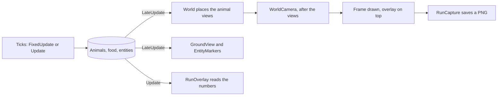

# Views and real time

The simulation runs on plain C# objects: animals are not GameObjects. What you see in Play mode is drawn by **views**
that read the World after each tick and never write to it. Animal views are bodies that follow their animals. Run views
are a painted ground, markers for carcasses and eggs, an on-screen panel of numbers, a camera you can steer, and
screenshots. Because nothing visual feeds back into the run, a run gives the same events hash whether it is drawn or not,
at any frame rate (SPACE-12, RAND-11).

## How it works

Each frame, Unity first runs the ticks the run speed allows, then the views read the result.

1. **Pools.** When a run starts in Play mode, the World makes one <xref:EvoSim.ViewPool> per species that has a
   <xref:EvoSim.Body>. The pools live under a *Views (runtime)* object under the World, which is never saved. Each pool
   makes **Prewarm** views ahead, by default as many as the species' initial population.
2. **Take and return.** In its `LateUpdate`, the World gives a view to each new animal
   ([Take](xref:EvoSim.ViewPool.Take(System.Int32))) and takes back the view of each animal that is gone
   ([Return](xref:EvoSim.ViewPool.Return(EvoSim.AnimalView))). A view is reused: it holds only the animal's id
   (<xref:EvoSim.AnimalView.AnimalId>).
3. **Placing.** The World puts each view between its animal's position at the previous tick and its position now, sets
   its height from the ground, and turns it toward where the animal moved (or its heading when it stood still).
4. **OnShow.** The World then calls [OnShow](xref:EvoSim.AnimalView.OnShow(EvoSim.Animal)) on the view, which may change
   colours or animations. The reference view, <xref:EvoSim.ActionView>, colours a marker above the head by the current
   action and darkens the body as its energy drops.

Views can't change what animals sense: every view part is on layer 2, *Ignore Raycast*
(<xref:EvoSim.ViewPool.IgnoreRaycastLayer>), which every sense ray leaves out, and every collider of a view is disabled.

### Interpolation

Ticks are discrete: an animal jumps from one position to the next. To make movement smooth, the World places each view
at a fraction of the way between the two positions: <xref:EvoSim.World.InterpolationFactor>, the part of the next tick
already elapsed.

| Run speed | Interpolation factor |
|---|---|
| *PerFixedUpdate* | the time since the last physics step, divided by the physics step |
| *RealTime* | the ticks the real-time clock owes, between 0 and 1, while running |
| *Fast* | 1: many ticks per frame, nothing to smooth |
| any, while the tick waits for a brain or the mutator | 1: views rest where the last tick left them |

Turn **Interpolate Views** off on the World to see the raw tick positions.

## The main types

| Type | Role |
|---|---|
| <xref:EvoSim.Body> | a species module: the view prefab (or a placeholder capsule), its colour and size |
| <xref:EvoSim.AnimalView> | the component on a body's root; the World calls `OnShow` on it every frame |
| <xref:EvoSim.ActionView> | the reference view: marker coloured by action, body darker when hungry |
| <xref:EvoSim.ViewPool> | the reusable views of one species |
| <xref:EvoSim.ActionColors> | one colour per action name, shared by views and the overlay |
| <xref:EvoSim.GroundView> | paints a flat world's ground, cover and food |
| <xref:EvoSim.EntityMarkers> | one small marker per carcass, egg or other entity |
| <xref:EvoSim.RunOverlay> | the panels of numbers, drawn in the editor and in a build |
| <xref:EvoSim.RunNumbers> | what the overlay shows, read from the World's own counters |
| <xref:EvoSim.WorldCamera> | the camera: pan, zoom, orbit, follow an animal |
| <xref:EvoSim.RunCapture>, <xref:EvoSim.ContactSheet> | screenshots of the run and a sheet of thumbnails |

## The run views

The reference scenes have a *Run views* object at the scene root, outside the World, with <xref:EvoSim.GroundView>,
<xref:EvoSim.EntityMarkers>, <xref:EvoSim.RunOverlay> and <xref:EvoSim.RunCapture>, and a <xref:EvoSim.WorldCamera> on
the main camera. *EvoSim ▸ Views ▸ Add Run Views to Reference Scenes* adds whatever is missing to the six reference
scenes (and rebuilds the two reference bodies). In a scene of your own,
add the four components to any GameObject and the camera component to the camera. Each one finds the first World of the
scene when its **World** field is empty.

### Ground

<xref:EvoSim.GroundView> draws a flat ground as one quad with a texture of one pixel per cell, the finest cell of the
food and cover layers. A pixel is **Food** colour when its cell holds a food item, **Cover** colour when it is in cover,
**Soil** colour otherwise. The texture is repainted once per tick and uploaded only when a pixel changed. **Show Cover**
and **Show Food** switch the layers off. A terrain ground is not painted: the terrain shows itself.

### Entities

<xref:EvoSim.EntityMarkers> places one marker per entity of every entity kind under the World: a dark red disc 0.8 m wide
per carcass, an ivory ball per egg, a grey 0.3 m cube for any other kind. The colours are the **Carcass**, **Egg** and
**Other** fields. Used-up entities get no marker.

### Action colours

Bodies and the overlay's legend share these colours (<xref:EvoSim.ActionColors>):

| Action | Colour |
|---|---|
| eat | green |
| flee | yellow |
| hide | blue |
| follow | cyan |
| rest | grey |
| mate | pink |
| hunt | red |
| searching (the action had nothing to act on, ACT-04) | white |
| no decision yet | dark grey |
| any other action name | a colour made from the name's letters, the same on every run |

### The overlay

<xref:EvoSim.RunOverlay> draws two panels with Unity's immediate-mode GUI, so they also appear in a player build. **Tab**
hides and shows them. The text scales with the window's height (**Font Size** 16 at 1080 lines).

The run panel, top left:

| Line | Example | Meaning |
|---|---|---|
| tick and state | `Tick 412   running` | also *paused*, *stopped: tick limit*, or *waiting for JEV: 12 queries, 1.4 s* |
| pace | `Ticks/s 4.9 of 5   FPS 118` | ticks per second over the last second, against the target of the run speed |
| one line per species | `Prey: 31 living, 40 born, 33 died, 2 eggs, gen 3` | kills and eggs appear when not zero; *gen* is the highest generation |
| mutations | `Mutations 5 ok, 1 failed of 7` | new alleles, failed mutations, mutations started |
| model calls | `Model calls: brain 245, mutator 5; cache 30, memo 400` | calls to the models, answers from the cache and the memo |

Under it, the legend shows each action name of the world once, plus *search*, in its colour. The animal panel, top
right, appears when the camera follows an animal: its species and id, age, generation, action, stats, the probabilities
of its last decision, and its genes. When it dies, the panel says it is gone.

All the numbers come from <xref:EvoSim.RunNumbers>, which reads the World's counters and nothing else; a play-mode test
checks them against the event log.

### The camera

<xref:EvoSim.WorldCamera> frames the whole world when the run starts. It reads the keys and mouse in real time, so it
works while the run is paused or waits for a brain.

| Control | Effect |
|---|---|
| W A S D or the arrow keys | pan (stops following) |
| mouse wheel | zoom, from 3 m to 2 000 m (not over a panel) |
| right mouse button, held | orbit left and right, tilt up and down (10° to 89°) |
| Q, E | orbit left, right |
| middle mouse button, held | drag the ground (stops following) |
| F | frame the whole world again (stops following) |
| left click on an animal | follow it |
| Esc | stop following |
| Tab | hide or show the overlay |

A click picks the living animal whose view is nearest on screen, within **Pick Pixels** (24 at 1080 lines). Views have
no colliders, so picking compares screen positions, never rays. A click on an overlay panel doesn't pick: the overlay
gives the camera its [Covers](xref:EvoSim.RunOverlay.Covers(UnityEngine.Vector2)) test through
<xref:EvoSim.WorldCamera.Blocks>. When you start following an animal, the camera comes as close as **Follow Distance**
(15 m) and then keeps the animal in the centre. Other fields: **Pitch** (55°), **Yaw**, **Pan Speed** (0.8 camera distances per second), **Orbit Speed** (90° per
second).

### Captures

<xref:EvoSim.RunCapture> saves what the screen shows, overlay included, as PNG files: one when the run starts, one every
**Every Seconds** of real time (10; 0 for the start and end only), and one when the run stops. Then it makes
`contact_sheet.png`: up to 24 thumbnails, 4 per row, evenly spread over the run, the first and the last kept
(<xref:EvoSim.ContactSheet>).

Files land in **Folder**/*run*/, by default `Logs/EvoSim/captures/<run>/`, where *run* is the name of the run folder
the recorder writes under `Logs/EvoSim/runs/`. Without a recorder it is the World's name, seed and start time. Each
file is named `NNN-tTTTTTT-label.png`: the capture number, the tick, and *start*, *t* or *end*. In a player build the
folder is next to the exe; `-capture S` sets the seconds, `-capture off` turns captures off
([Running and building](running-and-building.md)).

> [!NOTE]
> Captures need drawn frames. In batch mode with `-nographics` nothing is captured. In the editor, keep the Game view
> visible: a capture that gets no frame for 5 s is given up and counted in <xref:EvoSim.RunCapture.Skipped>.

## Watching in real time

The run speed decides how many ticks run per frame; the World's run settings are in
[Running and building](running-and-building.md). To watch, use *RealTime* with **Real Time Ticks Per Second** at 5 or 20.

When a tick needs answers from a model, it stops at the phase that needs them until every answer is in (SPACE-13).
*waiting for JEV: 12 queries, 1.4 s* means that the *Choose actions* phase waits for 12 queries sent to the brain named
JEV, for 1.4 s so far. *waiting for the mutator: 2 eggs* means the *Hatch* phase waits for the mutated genes of 2 eggs
that are due to hatch. In the *Responsive* wait mode, Unity keeps drawing meanwhile: the views rest, the camera and the
overlay still work. In *Freeze* mode the main thread blocks, so the window doesn't redraw until the answers arrive.
Either way the run is the same (SPACE-14).

So the pace you see is the slower of the target and the models. In the reference test of HideVsFlee with JEV and the
mutator live, the overlay showed about 0.55 ticks per second for a target of 5; the same run replayed from the answer
cache kept the target. After a wait the real-time clock doesn't catch up in a burst: it owes at most a tenth of a
second of ticks (or one tick).

## Settings

| Where | Field | What it does | Reference |
|---|---|---|---|
| World | **Show Views** | draw the animals | on |
| World | **Interpolate Views** | place views between tick positions | on |
| World | **Views Outside Play Mode** | also make views outside Play mode (tests leave it off) | off |
| Body | **Prefab**, **Color**, **Size**, **Prewarm** | the view prefab or capsule colour, size in meters, views made ahead | prey 0.6 m, predator 0.9 m |
| ActionView | **Hungry Brightness** | brightness of the body at zero energy | 0.35 |
| RunOverlay | **Font Size**, **Visible** | text size at 1080 lines; panels shown | 16, on |
| RunCapture | **Every Seconds**, **Folder**, **Contact Sheet** | capture period, folder, make the sheet | 10, `Logs/EvoSim/captures`, on |

## In the editor

During Play mode the views are under *World ▸ Views (runtime)*. Select one in the Hierarchy or the Scene view, and
*Window ▸ EvoSim ▸ Animal Inspector* shows its animal. See [Editor tooling](editor-tooling.md) for the other windows.

## Go further

- [Views](../extending/views.md): your own <xref:EvoSim.AnimalView>, a body prefab, markers for your entities, a panel
  of your own.
- [Determinism and replay](determinism.md): why the hash doesn't depend on rendering.
- Specification: [02 — Space and time](../spec/02-space-and-time.md) (SPACE-12 to SPACE-14).
