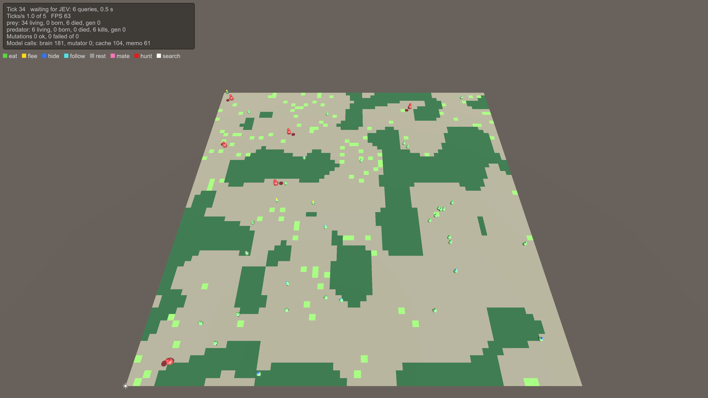

# EvoSim: evolving animals in Unity

Animals whose behaviour is written in English. Each gene is a short sentence, such as *"Run from any predator you
see."* At every decision, a language model reads an animal's genes together with what it senses, and gives a
probability for each action it could take. Animals eat, flee, hide, hunt and mate. Their babies inherit a mix of their
parents' sentences, and now and then a sentence mutates. Over generations, the sentences that keep animals alive spread.

*The HideVsFlee scene at tick 34. Light green cells are grass and dark green cells are thickets where prey can hide. The
ball above each animal shows its current action: green eat, yellow flee, blue hide, red hunt, and so on. The panel
counts living animals, births, deaths and model calls.*

## Where to start

| You want to… | Read |
|---|---|
| open a scene and watch it run | [Getting started](guides/getting-started.md) |
| understand the whole loop in one page | [How EvoSim works](guides/overview.md) |
| learn one part in depth | the [guides](guides/index.md): the world, a tick, senses, brains, actions, genes, mutation… |
| add a sense, an action, a gene, a brain, a phase… | [Extending EvoSim](extending/index.md), then the page for your kind of module |
| rewrite a reference module as an exercise | [The teaching path](extending/exercises.md) |
| look up a class or a method | the [API reference](api/index.md), grouped by folder |
| know exactly what must hold (rule `SENSE-01`, `DEC-30`…) | the [specification](spec/README.md) |

## Three ideas to keep in mind

1. **The scene is the configuration.** A world is a tree of GameObjects. Every feature (a sense, an action, a gene, a
   tick phase, a brain) is a component in that tree. Add a component and its feature is in. Disable it and the feature
   is gone. No code changes needed.
2. **Animals are data.** An animal is a plain C# object, not a GameObject. Phases process all animals in batches, and the
   visible bodies only display them.
3. **A seed replays a run exactly.** Every random draw comes from a named stream seeded by the World. The same seed and
   the same answers from the brain give the same run, event for event. Your modules must keep this: see
   [Determinism and replay](guides/determinism.md).

## About this site

The [API reference](api/index.md) is generated from the documentation comments in the code (`///`). The
[specification](spec/README.md) is the contract the code implements (`Docs/Interface` in the repository). Each rule id
in the text, such as SENSE-01, links to its rule. To document your own code the same way, see
[Documenting your code](extending/documenting-your-code.md).
